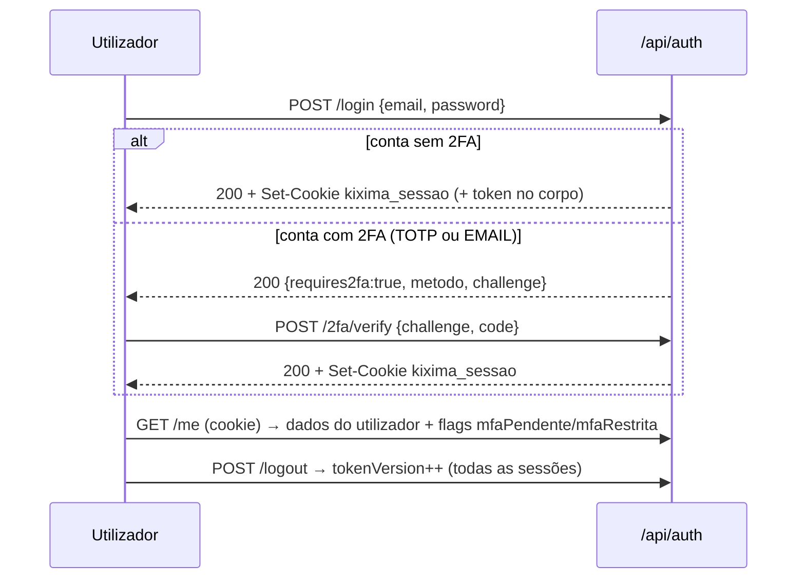

# 02 · Autenticação, permissões e limites

> Fontes: `backend/src/middleware/{auth,rbac,rateLimit}.js`, `utils/sessionCookie.js`, `services/{authService,mfaPolicy}.js`, `config/{env,cors,csp}.js`. Os achados de segurança citados (SEG-xx) estão detalhados em [07-seguranca.md](07-seguranca.md).

## 1. Como uma sessão funciona

| Elemento | Comportamento verificado no código |
|---|---|
| Credencial | JWT **HS256** assinado com `JWT_SECRET`, com `sub` (id do utilizador), `role`, `companyId` e `tv` (`tokenVersion`). Expiração em `JWT_EXPIRES_IN` (1 dia no código e no `render.yaml`; o `.env.example` indica 7 dias — ver SEG-26). `services/authService.js:20-28` |
| Onde viaja | **Cookie `kixima_sessao`** (`httpOnly`, `Secure` em produção, `SameSite=Lax`, `path=/`) tem prioridade; senão `Authorization: Bearer <token>`. `middleware/auth.js:17-24`, `utils/sessionCookie.js` |
| Emissão | `POST /api/auth/login` (e `POST /api/auth/2fa/verify`): define o cookie e devolve também o token no corpo (usado pela app móvel). |
| Validação por pedido | `authenticate` (`middleware/auth.js:26-`): verifica a assinatura, vai à base buscar o utilizador (tem de estar `active`) e compara `tv` com `User.tokenVersion`. Preenche `req.user` com `id, role, adminAreas, companyId, companyType, companyPlan, approvalCap, name, email, avatarUrl, mfaPendente, mfaRestrita, mfaPrazo`. |
| Revogação | Incrementar `tokenVersion` (logout, troca de senha, bloqueio) invalida todos os tokens anteriores. `POST /api/auth/logout` revoga **todas** as sessões do utilizador, em todos os dispositivos. |
| Sessão opcional | `optionalAuthenticate` nunca bloqueia (usado em rotas que variam consoante haja sessão). |
| Fim de sessão no tempo real | O Socket.IO só valida o token no *handshake*; revogar a sessão não desliga um socket já aberto (SEG-19). |

### ⚠️ Falha crítica conhecida (SEG-01)
`authenticate` **não verifica o tipo do token** (`t`). O *desafio da 2FA* (`t:'2fa'`, emitido só com a senha) e o token de recuperação de senha (`t:'pwreset'`) são assinados com o mesmo segredo e têm `sub` e `tv`, logo são aceites como sessão completa. Efeito: quem só tem a senha de uma conta com 2FA pode usar o desafio como `Bearer` durante 15 min e contornar o segundo factor. Confirmado por leitura (`middleware/auth.js:33-51`, `services/authService.js:97-111,345-351`) e por prova de conceito local sem base de dados. **Não foi corrigido** (esta tarefa é só documentação).

## 2. Fluxos de autenticação

- **Recuperação de senha:** `POST /forgot-password` responde sempre 200 (anti-enumeração); o email leva um link com token `pwreset` (1 h); `POST /reset-password` define a nova senha e revoga sessões.
- **Convites:** tokens `invite` (7 dias) para funcionários (`/api/companies/invite/:token`) e assessores da KIXIMA (`/api/admin/invite/:token`). Cada um tem `GET` (ver convite) e `POST …/accept`.
- **Registo público de empresa:** `POST /api/companies/register` (cria empresa + Company Admin, fica a aguardar aprovação da KIXIMA).
- **Bloqueio por conta:** 5 falhas de senha fecham a conta por tempo crescente (`loginAttemptService`). Falhas no 2.º factor **não** contam (SEG-04).
- **Política de senhas:** mínimo 10 caracteres (12 para `COMPANY_ADMIN`, `FINANCEIRO`, `ADMIN_SISTEMA`) e lista curta de senhas proibidas (`utils/passwordPolicy.js`).

### 2FA obrigatória (`services/mfaPolicy.js`)
- Métodos: **TOTP** (`utils/totp.js`) ou **código por email** (`mfaEmailService.js`).
- Papéis obrigados por omissão: `ADMIN_SISTEMA`, `COMPANY_ADMIN` (`MFA_REQUIRED_ROLES`). Só passa de aviso a bloqueio a partir de `MFA_ENFORCE_FROM` (não definida no `render.yaml` — SEG-11).
- Depois do prazo, a sessão fica **restrita** (`mfaRestrita`): só passam `/api/auth/(me|logout|2fa/*)`, `/api/users/profile` e `/api/notifications`; o resto responde `403 FORBIDDEN`.

## 3. Papéis e permissões

| Papel (`PersonaRole`) | Quem é | Capacidades principais (ver `x-permissoes` no `openapi.yaml`) |
|---|---|---|
| `COMPRADOR` | Funcionário de empresa cliente | Pesquisar/comprar, emitir POs, cotações (RFQ), chat comercial |
| `COMPANY_ADMIN` | Administrador de empresa (cliente ou fornecedora) | Aprovar/rejeitar POs, gerir utilizadores/convites, política de compras, plano, ERP (consulta) |
| `FORNECEDOR` | Funcionário de empresa fornecedora | Catálogo, aceitar/recusar POs, expedir, entregar, facturação, SAF-T da sua empresa |
| `FINANCEIRO` | Financeiro de uma empresa | Pagar facturas com comprovativo, painel financeiro; **também acede à conciliação bancária (SEG-02)** |
| `ADMIN_SISTEMA` | Pessoal interno da KIXIMA | Aprovar empresas, subscrições, apólices, suporte, operações, AGT. Âmbito por **áreas** |

Áreas de `ADMIN_SISTEMA`: `cadastro`, `financeiro`, `faturacao`, `apolices`, `suporte`, `operacoes`. **Lista vazia = Super Admin** (acede a tudo; só ele gere utilizadores e áreas dos assessores).

### Middlewares de autorização (`middleware/rbac.js`)
| Middleware | Efeito |
|---|---|
| `requireRole(...papéis)` | `403 FORBIDDEN` («Esta ação requer um dos seguintes perfis: …») se o papel não estiver na lista. |
| `requirePermission(area)` | Só filtra `ADMIN_SISTEMA`: exige a área (ou Super Admin). Não afecta os outros papéis — usar sempre depois de `requireRole`. |
| `requireSuperAdmin()` | Só `ADMIN_SISTEMA` com `adminAreas` vazio. |
| `requireSameCompany(fn)` | Definido, **nunca usado** (SEG-27). |

### Autorização por posse (dentro dos services)
Quase todos os recursos pertencem a uma empresa. Os services filtram por `req.user.companyId` (ex.: PO visível ao comprador **ou** ao fornecedor; conversas só aos participantes). Numa amostra de 28 rotas com `:id`/`companyId`, 26 isolam correctamente; falham `PATCH /api/notifications/:id/read` e a conciliação bancária ([07](07-seguranca.md), secção 4). Os *handlers* devolvem normalmente `404` quando o recurso é de outra empresa.

## 4. Outras formas de autenticação

| Mecanismo | Onde | Notas |
|---|---|---|
| **Chave de API do catálogo** (`/api/v1/catalogo*`) | `routes/apiCatalogoRoutes.js` | A empresa fornecedora gera uma chave (mostrada uma só vez, guardada com bcrypt); revogação imediata. Limite de 120/min **por chave** que, na prática, não se atinge porque o `apiLimiter` global (600/15 min por IP) se aplica primeiro (SEG-14). |
| **HMAC do callback ERP** | `POST /api/integration/callback` | HMAC-SHA256 do corpo bruto com `KIXIMA_CALLBACK_SECRET`, comparação em tempo constante, falha fechada; sem *timestamp*/nonce (SEG-24). |
| **Webhook de pagamento** | `POST /api/webhooks/pagamento/:canal` | **Sem assinatura.** Defesa: reconsulta o gateway com o `id` recebido; ignora montante e moeda (SEG-12). Só activa subscrições, não pagamentos de PO. |
| **Chave de equipa** (modo de lançamento) | `?acesso=<chave>` → cookie `kixima_equipa` (HMAC) | Só serve para ver o SPA enquanto `launch.json` tem `enabled:true`; não dá sessão de API. A chave aparece nos logs do `morgan` (SEG-06). |
| **Tokens de convite / recuperação** | URL | Tipos `invite`, `pwreset`; ver SEG-01 e SEG-06. |

## 5. Limites de pedidos (`middleware/rateLimit.js`)

| Limitador | Janela e máximo | Chave | Onde |
|---|---|---|---|
| `apiLimiter` | 600 / 15 min (`API_RATE_LIMIT`) | utilizador (token válido) ou IP | todo `/api/` |
| `authLimiter` | 60 / 15 min (`AUTH_RATE_LIMIT`), só conta falhas | IP | `POST /api/auth/login`, `/auth/2fa/verify`, `/auth/reset-password` |
| `forgotPasswordLimiter` | 10 / 15 min | IP | `POST /api/auth/forgot-password` |
| `sensitiveLimiter` | 30 / 15 min | IP | `/api/companies/register`, `/api/companies/invite`, `/api/admin/invite` |
| `chatMessageLimiter` | 60 / min (`CHAT_RATE_LIMIT`) | utilizador ou IP | envio de mensagens de chat |
| limitadores próprios | — | — | feedback público (10/15 min por IP), API de catálogo por chave (120/min) |

Em teste (`NODE_ENV=test`) os limitadores estão desligados. `/health`, `/ready` e `/api/uploads` estão montados **antes** do `apiLimiter` (SEG-14). Resposta ao exceder: `429 RATE_LIMITED`.

## 6. Cabeçalhos, CORS e CSP

- `helmet` + CSP derivada (`config/csp.js`); `style-src 'unsafe-inline'` mantido (SEG-31).
- CORS com lista de origens (`CORS_ORIGINS`) e `credentials:true`; aceita `https://localhost` e `capacitor://localhost` para a app móvel. Em `NODE_ENV` diferente de `production` aceita qualquer origem (SEG-22).
- Não há protecção CSRF além de `SameSite=Lax`; existe pelo menos um `GET` com efeito externo (`/api/faturacao/agt-serie-payload`, SEG-05).
