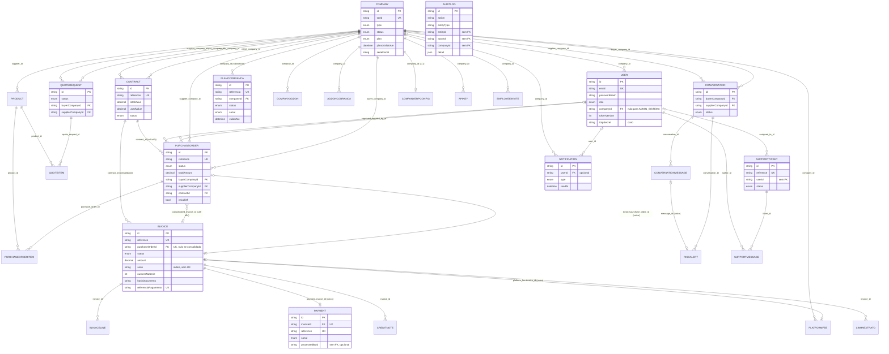

# Base de dados do KIXIMA (Prisma + PostgreSQL/Supabase)

> Gerado por análise estática de `backend/prisma` e `backend/src` (nenhuma base de dados foi contactada). Não contém connection strings nem segredos.

Âmbito: `backend/prisma/` (`schema.prisma`, `migrations/`, seeds), `backend/src/config/database.js`, jobs em `backend/src/jobs/` e a ligação ao Supabase.
Método: leitura estática. Não se correu `migrate`, `generate`, `seed` nem se ligou a nenhuma base. Nenhum valor de segredo, palavra-passe ou connection string é reproduzido; só nomes de variáveis. Os números de linha são do estado actual do repositório.

Convenção de caminhos: `schema.prisma:N` = `backend/prisma/schema.prisma`; `src/...` = `backend/src/...`.

---

## 0. Resumo executivo

- 49 modelos e 36 enums em `schema.prisma` (1992 linhas), 53 migrações (`0_init` + 52 incrementais), PostgreSQL com `provider = "postgresql"` (`schema.prisma:9-17`).
- A aplicação liga via Prisma ao pooler de transacção do Supabase (`DATABASE_URL`, porta 6543, `pgbouncer=true`); migrações e `pg_dump` usam o pooler de sessão (`DIRECT_URL`, porta 5432).
- O Supabase é usado só como Postgres gerido e como armazenamento S3-compatível. Não usa Supabase Auth, nem RLS, nem o cliente `supabase-js`, nem Realtime do Supabase. A autenticação é própria (JWT HS256 + cookie, bcrypt) e todo o acesso à base é via Prisma.
- Pontos mais graves (detalhe na secção 9): ficheiros privados (comprovativos, documentos de credenciamento, apólices, anexos de chat) ficam num bucket público em produção e a verificação de posse só existe em modo `local`; sem RLS em 49 tabelas do schema `public`; seeds com contas de teste e palavra-passe fixa sem protecção por `NODE_ENV`; a conciliação bancária paga a fatura mas não actualiza a PO, não gera a taxa da plataforma e perde o registo de auditoria.

---

## 1. Como a aplicação liga à base de dados

### 1.1 Variáveis e papéis

| Variável | Papel | Onde é lida | Notas |
|---|---|---|---|
| `DATABASE_URL` | Ligação da aplicação (runtime). Pooler de **transacção** do Supabase, porta 6543, com `pgbouncer=true` e `sslmode=require` | `schema.prisma:12` (`url = env(...)`); `src/config/env.js:199` (obrigatória em produção), `:245`; `src/services/prontidaoService.js:92-111` valida-a | Em dev/teste aponta para Postgres local |
| `DIRECT_URL` | Ligação para DDL e cópias. Pooler de **sessão** do Supabase (mesmo host `...pooler.supabase.com`, porta 5432) | `schema.prisma:16` (`directUrl = env(...)`); `src/config/env.js:249`; `scripts/migrate-boot.js:85`; `src/jobs/backupJob.js:35-37`; `scripts/backup.js:30`; `scripts/restore-test.js:24` | O schema declara-a obrigatória (`env()` sem default): sem ela, `prisma migrate`/`db push` falham. Em teste local é igual a `DATABASE_URL` (`tests/env.js:15-16`) |
| `DB_MAX_ROWS` | Tecto por omissão de linhas em `findMany` (1000) | `src/config/database.js:29` | Ver 1.3 |
| `SOURCE_DATABASE_URL` / `TARGET_DATABASE_URL` | Só para `scripts/copiar-catalogo-producao-teste.js` | `scripts/copiar-catalogo-producao-teste.js:25-26` | Recusa-se a correr se forem iguais (`:34`) |

Racional escrito no código: o host directo `db.<ref>.supabase.co` só resolve em IPv6 e o Render não tem IPv6 (erro P1001), por isso usa-se sempre o pooler (`schema.prisma:11-15`; `.env.example:17-27`; `src/services/prontidaoService.js:31-35`).

### 1.2 pgbouncer, pool e migrações

- `pgbouncer=true`: não é definido em código; vem na própria `DATABASE_URL`. O serviço de prontidão (`src/services/prontidaoService.js:92-111`) analisa a URL e dá FALHA se usar o host directo `db.*.supabase.co`, AVISO se não for porta 6543 com `pgbouncer=true`, OK caso contrário. Valida também a `DIRECT_URL`: tem de ser porta 5432 e faz uma ligação real de 8 s (`testarLigacaoDireta`, `:55-74`).
- `connection_limit` / `pool_timeout`: não existem em nenhum ficheiro do backend Node (grep ao repositório só os encontra no teste e no conversor JDBC do `backend-java`: `DatabaseUrlEnvironmentPostProcessor.java:60`). O tamanho do pool do Prisma fica, portanto, no valor por omissão do Prisma, salvo se a `DATABASE_URL` real o trouxer no query string. Não confirmado (a URL real não foi lida, por regra).
- Instância única do cliente: `src/config/database.js:35-37` cria `new PrismaClient({ log: ['warn','error'] | ['error'] })` e exporta-o com `$extends` (`:39-62`). Há duas excepções legítimas: `prontidaoService.js:61-63` (ligação de teste à `DIRECT_URL`) e `scripts/migrate-boot.js:85` (`datasourceUrl: DIRECT_URL`).
- Migrações com `DIRECT_URL`: o Prisma usa `directUrl` automaticamente em `migrate deploy`. O arranque do contentor (Dockerfile raiz, `CMD` na linha 77) corre `node scripts/migrate-boot.js`, que executa `prisma migrate deploy` e, se falhar, tenta reconciliar três estados conhecidos (P3005 sem histórico, P3009 migração falhada, checksum alterado) e **nunca bloqueia o arranque do servidor** (`scripts/migrate-boot.js:4-30, 141-186`; termina sempre com `process.exit(0)`, `:186`).
- Interactive transactions e `SELECT ... FOR UPDATE` passam pelo pooler de transacção (cada transacção prende uma ligação durante a sua duração). Nenhum `$transaction` define `maxWait`/`timeout` (grep sem resultados), logo aplicam-se os valores por omissão do Prisma. Não confirmado o efeito sob contenção das séries fiscais.
- Prontidão/saúde: `GET /health` (processo vivo, não toca na BD) e `GET /ready` (`SELECT 1` com timeout de 3 s, 503 se falhar) em `src/app.js:112-135`.
- Encerramento: `SIGTERM`/`SIGINT` fecham o servidor e chamam `prisma.$disconnect()` (`src/server.js:69-78`).

### 1.3 Extensão do cliente: tecto de leituras (`src/config/database.js`)

`$extends.query.$allModels.findMany` aplica `take: 1000` (configurável por `DB_MAX_ROWS`) a qualquer `findMany` sem `take` (excepto o modelo `referenceCounter`, `:33`). Se o resultado chegar exactamente ao tecto, regista `logger.error` com o modelo e a linha de origem (`:45-57`), mas **devolve o resultado truncado** sem erro. Quem quer tudo tem de passar `take` explícito (ex.: `saftService.js:109` usa `take: 100000`). Só actua no `findMany` de topo, não em `include` aninhados nem em `findFirst`/`groupBy`.

### 1.4 Diferenças de documentação/deploy (não resolvidas)

- `render.yaml:10-13` diz para definir `DATABASE_URL` como "Session mode, porta 5432" e que "`prisma db push` cria as tabelas"; isso contradiz `prontidaoService.js:104-107` (exige 6543 + pgbouncer), `DEPLOY.md:59` e o `CMD` do Dockerfile raiz (migrate-boot). O `render.yaml` do serviço Java (`:196-210`) volta a pedir "Session mode, 5432" por exigência do JDBC. O valor real em produção não foi lido.
- `backend/Dockerfile:31` arranca com `npx prisma db push --skip-generate`, e é o Dockerfile usado por `docker-compose.yml` (`build: ./backend`). `db push` ignora o SQL das migrações (ver 3.4). O Dockerfile raiz (usado pelo Render, `render.yaml:21`) usa `migrate-boot`. `docker-compose.yml` não define `DIRECT_URL`; como o schema a exige, o `db push` do compose provavelmente falha. Não confirmado (não se executou).

---

## 2. Modelos, enums, relações e restrições

Todas as tabelas têm `@@map` em snake_case plural (49 de 49) e as colunas têm `@map` em snake_case. As chaves primárias são `String @id @default(uuid())` (texto, gerado pelo Prisma), excepto `ReferenceCounter` (`key`) e `SupportCategoryImage` (`key`). Dinheiro: `Decimal(14,2)` (e variantes), nunca `Float`. Moeda por omissão: `AOA` (`USD` nas taxas/planos).

### 2.1 Empresas, utilizadores e acesso

| Modelo (tabela) | Finalidade | Campos-chave | Relações / FKs | Índices e únicos |
|---|---|---|---|---|
| `Company` (`companies`, `:244`) | Empresa cliente ou fornecedora | `taxId`, `type` (`CompanyType`), `status` (`CompanyStatus`), `plan`, `planoValidoAte`, `size`, `searchRank`, `searchText` (mantido por gatilho), `serieFiscal`, `dataAdesaoFacturacaoElectronica`, `iban/swift/bankName`, `settings Json`, `seatPriceUsd`, `ultimoAvisoSubscricaoTier` | 1:N para quase todo o resto (users, products, POs comprador/fornecedor, contratos, apólices, notificações, cotações, conversas, cobranças, add-ons, regras do robot, feedback, ERP) | `taxId` único. Não há índice em `status`/`type` |
| `User` (`users`, `:498`) | Conta de utilizador | `email` (único), `passwordHash`, `role` (`PersonaRole`), `adminAreas String[]`, `approvalCap`, `active`, `tokenVersion`, `mfaMethod`, `totpSecret`, `totpEnabledAt`, `mfaCodeHash/ExpiraEm/Tentativas/EnviadoEm`, `falhasSeguidas`, `bloqueadoAte`, `locale`, `avatarUrl` | `companyId` opcional → `Company` (nulo para `ADMIN_SISTEMA`) | `email` único; `@@index([companyId])` |
| `EmployeeInvite` (`employee_invites`, `:414`) | Convite de funcionário ou de assessor Admin | `email`, `role`, `adminAreas`, `token` (único), `status` (`InviteStatus`), `expiresAt` | `companyId` opcional → `Company` (cascade) | `token` único; índices `companyId`, `email`. Sem único `(companyId,email)` |
| `CompanyDocument` (`company_documents`, `:485`) | Documento de credenciamento | `type` (`DocumentType`), `fileUrl`, `originalName` | `companyId` → `Company` (cascade) | índice `companyId` |
| `ApiKey` (`api_keys`, `:47`) | Chave da API de catálogo (plano Pro) | `prefixo` (único), `hash`, `ultimoUso`, `revogadaEm` | `companyId` → `Company` (cascade) | `prefixo` único; índice `companyId` |
| `SavedSearch` (`saved_searches`, `:582`) | Pesquisa guardada | `label`, `query` | `userId` → `User` (cascade) | índice `userId` |
| `BudgetLimit` (`budget_limits`, `:1448`) | Limite mensal de orçamento por empresa | `periodMonthly`, `currency` | `companyId` único → `Company` | 1:1 |

### 2.2 Planos, subscrições e add-ons

| Modelo | Finalidade | Campos-chave | Relações | Restrições |
|---|---|---|---|---|
| `PlanoCobranca` (`plano_cobrancas`, `:110`) | Pedido de plano e seu pagamento (a "Subscription" do sistema; o estado vigente fica em `Company.plan` + `planoValidoAte`) | `referencia` (único, `SUB-AAAA-nnnnnn`), `planoAtual/planoNovo`, `valorUsd` (gravado no pedido), `periodo` (String: MENSAL/TRIMESTRAL/ANUAL), `meses`, `status` (`CobrancaStatus`), `comprovativoUrl`, `canal` (`CanalCobranca`), `referenciaExterna`, `validoAte` | `companyId` → `Company` (cascade) | índices `companyId`, `status`, `(canal, referenciaExterna)`. **Único parcial só em SQL**: uma cobrança em aberto por empresa (`migrations/20260918000000_cobranca_unica_em_aberto`) |
| `AddonCobranca` (`addon_cobrancas`, `:187`) | Espelho de `PlanoCobranca` para add-ons | `referencia` (`ADD-...`), `addonKey`, igual ao anterior | `companyId` → `Company` (cascade) | Único parcial em SQL `(company_id, addon_key)` em aberto |
| `CompanyAddon` (`company_addons`, `:164`) | Add-on activo (ex. `PO_ROBOT`) | `addonKey`, `status` (`CompanyAddonStatus`), `validoAte` | `companyId` → `Company` (cascade) | `@@unique([companyId, addonKey])` |

Regra de negócio inscrita no schema: o plano/add-on só muda na confirmação da cobrança (`CONFIRMADA`), nunca no pedido (`schema.prisma:83-85, 154-158`).

### 2.3 Catálogo e marketplace

| Modelo | Finalidade | Campos-chave | Relações | Restrições |
|---|---|---|---|---|
| `Product` (`products`, `:598`) | Produto ou serviço do fornecedor | `supplierId`, `kind` (`ProductKind`), `unitPrice`, `promoPrice`, `currency`, `stockQuantity`, `minStock`, `unspsc*`, `slug` (único, nulo permitido), `active`, `rating`, `reviewCount`, `searchText` (gatilho), `certifications[]`, `tags[]` | `supplierId` → `Company` | `slug` único; índices `category`, `kind`, `supplierId`. Índice trigrama GIN em `search_text` só em SQL |
| `ProductImage`, `ProductDocument` | Galeria e documentos técnicos | `url`/`fileUrl`, `type` (`ProductDocType`) | `productId` (cascade) | índice `productId` |
| `StockMovement` (`:821`) | Movimento de inventário | `type` (`StockMovementType`), `quantity`, `createdById` (sem FK) | `productId` (cascade) | índice `productId` |
| `Kit`, `KitItem` | Pacotes de produtos | `supplierId`; `quantity` | `Kit`→`Company`; `KitItem`→`Kit` (cascade), →`Product` | índices |
| `Favorite` (`:710`) | Favorito | | `userId` e `productId` (cascade ambos) | `@@unique([userId, productId])` |
| `Review` (`:724`) | Avaliação 1..5 | `rating`, `comment` | `productId` (cascade), `userId` | `@@unique([productId, userId])` |
| `QuoteRequest`, `QuoteItem` (`:747, :773`) | RFQ comprador→fornecedor | `status` (`QuoteStatus`), `responsePrice`, `responseLeadDays`; `createdById` sem FK | `buyerCompanyId`, `supplierCompanyId` → `Company`; `QuoteItem`→`QuoteRequest` (cascade), →`Product` | índices por empresa |
| `DiscountThreshold` (`:1931`) | Escalões de desconto por volume (Category Management) | `minVolumeUsd`, `discountPercent`, `ativo` | — | índice `(ativo, minVolumeUsd)` |

### 2.4 Compras (PO), contratos e robot

| Modelo | Finalidade | Campos-chave | Relações | Restrições |
|---|---|---|---|---|
| `PurchaseOrder` (`purchase_orders`, `:891`) | Ordem de compra (fluxo central) | `reference` (único), `status` (`PoStatus`), `totalAmount` (com IVA), `netAmount`, `taxAmount`, `withholdingAmount`, `isCallOff`, `acceptedAt`, `paymentDueAt`, `paidAt`, `receptionStatus` (String), `divergenceResolution` (String), `erpManaged`, `erpExternalId`, `createdBySource` ("HUMANO"/"ROBOT"), `consolidatedInvoiceId` | `buyerCompanyId`, `supplierCompanyId` → `Company`; `createdById`, `approvedById` → `User`; `contractId` → `Contract`; `consolidatedInvoiceId` → `Invoice`; 1:N `items`; 1:1 `invoice` | índices `status`, `buyerCompanyId`, `supplierCompanyId`, `approvedById`, `contractId`, `createdById`, `consolidatedInvoiceId` |
| `PurchaseOrderItem` (`:1024`) | Linha da PO | `quantity`, `unitPrice`, `lineTotal` | `purchaseOrderId` (cascade), `productId` | índices |
| `Contract` (`contracts`, `:1536`) | Contrato-quadro e call-offs | `reference` (único), `categoriesCovered[]`, `totalValue`, `usedValue`, `billingPeriodicity`, `paymentTermDays`, `status`, `validFrom/Until` | `clientCompanyId`, `supplierCompanyId` → `Company`; 1:N `callOffs` (PO), `consolidatedInvoices` | índices por empresa |
| `PoRoboRegra` (`:1059`) | Regra do Automatic PO Robot (add-on PRO) | `mediaOrigem`, `mediaMensal`, `periodicidade`, `limiteMaximoUsd`, `proximaExecucaoEm`, `ativo` | `companyId` (cascade), `productId` | índices `companyId`, `(ativo, proximaExecucaoEm)` |
| `ErpSyncLog` (`:1009`) | Histórico de sincronização ERP por PO | `direction`, `eventType`, `status`, `externalId`, `errorMessage` (sem payload) | `purchaseOrderId` (cascade) | índice |

### 2.5 Facturação certificada (AGT), pagamentos e conciliação

| Modelo | Finalidade | Campos-chave | Relações | Restrições |
|---|---|---|---|---|
| `Invoice` (`invoices`, `:1103`) | Fatura (FT). Série fiscal própria do fornecedor, cadeia de hash | `reference` (único), `amount`, `netAmount`, `taxAmount`, `withholdingAmount`, `status` (`InvoiceStatus`), `issuedAt`, `dueAt`, `serie`, `numeroNaSerie`, `hashDocumento`, `hashAnterior`, `agtDocumentNo`, `agtRequestId`, `agtResultCode`, `agtErro Json`, `agtEstado Json`, `referenciaPagamento` (único), `consolidatedPoIds[]` | `purchaseOrderId` único opcional → `PurchaseOrder`; `contractId` → `Contract`; 1:1 `payment`, `platformFee`; 1:N `creditNotes`, `lines`, `linhasExtrato`, `consolidatedCallOffs` | `reference`, `purchaseOrderId`, `referenciaPagamento` únicos; índices `contractId`, `(serie, numeroNaSerie)`, `issuedAt`, `dueAt`, `status`. **Sem único em `(serie, numeroNaSerie)`** |
| `InvoiceLine` (`:1198`) | Linha fiscal (cópia da PO, IVA por linha) | `lineNumber`, `productCode`, `quantity`, `unitPrice`, `ivaAmount`, `ivaTaxCode` | `invoiceId` (cascade) | `@@unique([invoiceId, lineNumber])` |
| `CreditNote` (`credit_notes`, `:1235`) | Nota de crédito (NC), correcção fiscal | `reference` (único), `motivo`, `amount`, série/hash próprios, campos AGT | `invoiceId` → `Invoice` | índices `invoiceId`, `(serie, numeroNaSerie)` |
| `Payment` (`payments`, `:1403`) | Pagamento = recibo (RC) da AGT | `reference` (único), `status` (`PaymentStatus`), `canal` (`CanalPagamento`), `processedById` (opcional, sem FK), `proofUrl`, `receivedAt`, série/hash | `invoiceId` único → `Invoice` | `invoiceId`, `reference` únicos. Índice `(serie, numeroNaSerie)` |
| `PlatformFee` (`platform_fees`, `:375`) | Comissão KIXIMA por fatura | `poCount`, `perPo`, `perInvoice`, `amount`, `basis`, `poValueUsd`, `fxRate`, `status` (`PlatformFeeStatus`) | `companyId` → `Company`; `invoiceId` único → `Invoice` | índices `companyId`, `status` |
| `SerieFaturacao` (`series_faturacao`, `:1371`) | Série interna (contador + último hash) | `codigo`, `ano`, `ultimoNumero`, `ultimoHash`, `ativa` | sem FK (liga por `codigo`) | `@@unique([codigo, ano])` |
| `AgtSeriesFe` (`agtseriesfe`, `:1298`) | Séries reais solicitadas à AGT (DS.120) | `ano`, `tipoDocumento`, `seriesCode`, `authorizedQuantity`, `ultimoNumero`, `submissionUUID`, `resultCode` | sem FK | só índice `(ano, tipoDocumento)` |
| `LinhaExtrato` (`linhas_extrato`, `:1349`) | Linha do extrato bancário importado | `idNoBanco` (único, idempotência), `montante`, `estado` (String), `referencia` | `invoiceId` opcional → `Invoice` | `idNoBanco` único; índices `estado`, `referencia` |
| `ReferenceCounter` (`reference_counters`, `:358`) | Contador atómico de referências não fiscais (PO, FAT, CTR, SD, SUB, NC, ADD) | `key` (ex. "PO-2026"), `value` | — | PK |

### 2.6 Apólices, ERP e programa de fornecedores

| Modelo | Finalidade | Relações | Notas |
|---|---|---|---|
| `SupplierToKiximaPolicy` (`:1473`) | Apólice Fornecedor→KIXIMA (condição de credenciamento) | `companyId` → `Company` | `status` (`PolicyStatus`), `documentUrl`. Índice `companyId` |
| `KiximaToClientPolicy` (`:1496`) | Apólice KIXIMA→Cliente | `companyId` → `Company`; `issuedById` sem FK | `expiryAlertSentAt` evita repetir o aviso dos 30 dias |
| `CompanyErpConfig` (`:453`) | Configuração ERP por empresa, credenciais cifradas em `configEnc` | `companyId` único → `Company` (cascade) | `erp` (`CompanyErpSystem`) |
| `CompanyErpConfigAudit` (`:468`) | Auditoria de alterações ao ERP | `companyId` (cascade); `actorUserId` sem FK | |
| `SupplierDevRequest` (`:1886`) | Candidatura pública ao programa de apoio ao fornecedor nacional | `companyId` opcional | `reference` único; `accessFeeUsd`, `feeStatus` (`PlatformFeeStatus`), `track`, `status` |

### 2.7 Comunicação, suporte e feedback

| Modelo | Finalidade | Relações | Notas |
|---|---|---|---|
| `Notification` (`:1620`) | Notificação in-app/email | `userId` opcional → `User`; `companyId` opcional → `Company` | `type` (`NotificationType`), `channel`, `readAt`, `relatedEntityType/Id` polimórficos; índices `userId`, `companyId` |
| `SupportTicket` (`:1666`) | Pedido de suporte | `assignedToId` → `User`; `userId` e `companyId` **sem FK** | `reference` único; `status` (`SupportStatus`) |
| `SupportMessage` (`:1692`) | Mensagem do chat de suporte | `ticketId` (cascade), `authorId` → `User` | `authorRole` desnormalizado |
| `SupportCategoryImage` (`:1658`) | Imagem de categoria de ajuda | — | PK `key` |
| `Conversation` (`:1730`) | Chat comercial comprador↔fornecedor | `buyerCompanyId`, `supplierCompanyId` → `Company`; `createdById` sem FK | `contextType/contextId` polimórficos; índice `(contextType, contextId)` |
| `ConversationMessage` (`:1758`) | Mensagem | `conversationId` (cascade), `senderId` → `User` | `senderCompanyId` desnormalizado |
| `RiskAlert` (`:1805`) | Alerta Trust & Safety (risco ≥ MEDIUM) | `conversationId` (cascade); `messageId` único opcional; `reviewedById` → `User` | `level` (`RiskLevel`), `status` (`RiskAlertStatus`), `signals/context Json` |
| `Feedback` (`:1965`) | Avaliação da plataforma (moderada) | `userId` → `User`; `companyId` → `Company` | `categoria` (`FeedbackCategoria`), `approved` (false por omissão); índice `(approved, createdAt)` |
| `AuditLog` (`audit_logs`, `:1838`) | Trilho de auditoria | **sem FK** (ator desnormalizado) | `action`, `entityType`, `entityId`, `actorId/Name/Role`, `companyId`, `ip`, `detail Json`. Índices `(entityType, entityId)`, `actorId`, `createdAt`, `(companyId, createdAt)` |

### 2.8 Enums e valores

| Enum | Valores |
|---|---|
| `CompanyType` | CLIENTE, FORNECEDOR |
| `CompanySize` | MICRO, PEQUENA, MEDIA, GRANDE |
| `CompanyPlan` | BASE, CORE, PRO, BASICO (legado, tratado como sinónimo de CORE, `:69-72`) |
| `CompanyStatus` | PENDENTE, APROVADA, REJEITADA, SUSPENSA |
| `DocumentType` | CERTIDAO_COMERCIAL, ALVARA_COMERCIAL, LICENCA_ANPG |
| `PersonaRole` | COMPRADOR, COMPANY_ADMIN, FORNECEDOR, FINANCEIRO, ADMIN_SISTEMA |
| `CobrancaStatus` | PENDENTE, COMPROVATIVO_ENVIADO, CONFIRMADA, CANCELADA |
| `CanalCobranca` | TRANSFERENCIA_MANUAL, EMIS_MULTICAIXA, PAYPAY, BAI, BFA, STANDARD_BANK_ANGOLA |
| `CompanyAddonStatus` | INATIVO, ATIVO |
| `PlatformFeeStatus` | PENDENTE, COBRADO |
| `InviteStatus` | PENDENTE, ACEITO, EXPIRADO, CANCELADO |
| `CompanyErpSystem` | MANUAL, PRIMAVERA, SAP_S4HANA, ORACLE_ERP_CLOUD, SAP_ARIBA |
| `ProductKind` | PRODUTO, SERVICO |
| `QuoteStatus` | ABERTA, RESPONDIDA, FECHADA |
| `StockMovementType` | ENTRADA, SAIDA |
| `ProductDocType` | FICHA_TECNICA, DATASHEET, MANUAL, CATALOGO, CERTIFICADO, DESENHO_TECNICO |
| `PoStatus` | AGUARDANDO_APROVACAO, APROVADA, REJEITADA, ACEITE_FORNECEDOR, RECUSADA_FORNECEDOR, AGUARDANDO_PAGAMENTO, PAGA, EM_EXECUCAO, ENTREGUE, RECEBIDA_CONFORME, RECEBIDA_COM_DIVERGENCIA, CONCLUIDA |
| `ErpSyncDirection` | OUTBOUND, INBOUND |
| `ErpSyncStatus` | PENDING, SUCCESS, FAILED |
| `PoRoboMediaOrigem` | IA, MANUAL |
| `PoRoboPeriodicidade` | SEMANAL, QUINZENAL, MENSAL |
| `InvoiceStatus` | PENDENTE, PAGA, VENCIDA, CANCELADA |
| `PaymentStatus` | PROCESSADO, FALHOU |
| `CanalPagamento` | TRANSFERENCIA_MANUAL, REFERENCIA_BANCARIA, MULTICAIXA_EXPRESS, ERP |
| `PolicyStatus` | SUBMETIDA, APROVADA, REJEITADA, EXPIRADA |
| `ContractStatus` | ATIVO, EXPIRADO, ENCERRADO |
| `BillingPeriodicity` | TRIMESTRAL, SEMESTRAL |
| `NotificationChannel` | IN_APP, EMAIL, IN_APP_EMAIL |
| `NotificationType` | PO_AGUARDA_APROVACAO, PO_APROVADA, PO_REJEITADA, PO_RECEBIDA_FORNECEDOR, FATURA_GERADA, PAGAMENTO_PROCESSADO, ENTREGA_DESPACHADA, RECECAO_COM_DIVERGENCIA, DIVERGENCIA_RESOLVIDA, SUPPLIER_DEV_RECEBIDA, APOLICE_SUBMETIDA_APROVADA, APOLICE_A_EXPIRAR, CADASTRO_EMPRESA_APROVADO, CADASTRO_EMPRESA_REJEITADO, SUBSCRICAO_COMPROVATIVO, SUBSCRICAO_CONFIRMADA, SUBSCRICAO_A_EXPIRAR, SUPORTE_MENSAGEM, CHAT_COMERCIAL_MENSAGEM, ALERTA_SEGURANCA, PO_RECUSADA_FORNECEDOR, PO_ENTREGUE, PO_RECEBIDA_CONFORME, PO_CONCLUIDA, NOTA_CREDITO_EMITIDA, ESTOQUE_BAIXO |
| `SupportStatus` | ABERTO, EM_ANDAMENTO, AGUARDANDO_RESPOSTA, RESOLVIDO, FECHADO |
| `ConversationStatus` | ABERTA, FECHADA |
| `RiskLevel` | LOW, MEDIUM, HIGH, CRITICAL |
| `RiskAlertStatus` | ABERTO, EM_ANALISE, FALSO_POSITIVO, RESOLVIDO |
| `SupplierDevTrack` | BUROCRACIA, PARCERIA, AMBOS |
| `SupplierDevStatus` | RECEBIDA, EM_ANALISE, EM_ACOMPANHAMENTO, CONCLUIDA, REJEITADA |
| `FeedbackCategoria` | FORNECEDOR, PRODUTO, SERVICO, PEDIDO, ENTREGA, PAGAMENTO, ATENDIMENTO, EXPERIENCIA_GERAL |

Domínios fechados só por convenção (colunas `String`, sem enum nem `CHECK`): `PlanoCobranca.periodo`/`AddonCobranca.periodo` (MENSAL/TRIMESTRAL/ANUAL, `:122`), `CompanyAddon.addonKey`, `PurchaseOrder.receptionStatus`, `divergenceResolution` (ACEITE/REPOSICAO), `createdBySource` (HUMANO/ROBOT), `PlatformFee.basis`, `LinhaExtrato.estado`, `User.mfaMethod` (EMAIL/TOTP), `CompanyErpConfigAudit.action`, `SupportTicket.category`, `Conversation.contextType`.

Valores de enum declarados mas que o código nunca escreve (grep a `status: '...'` em `src/`): `PoStatus.ACEITE_FORNECEDOR`, `InvoiceStatus.VENCIDA` e `CANCELADA`, `PaymentStatus.FALHOU`, `PolicyStatus.EXPIRADA`. `VENCIDA` é derivada na leitura (`src/services/financeiroService.js:98`).

### 2.9 Constraints que só existem em SQL (não aparecem em `schema.prisma`)

- Gatilhos `products_search_text_trg` e `companies_search_text_trg` + função `kixima_normalizar()` (`migrations/20260831000000_pesquisa_sem_acentos` e `20260831010000_pesquisa_fornecedor`); preenchem `products.search_text` e `companies.search_text`.
- Índice GIN de trigramas em `products.search_text` (extensão `pg_trgm`, criada num bloco `DO $$ ... EXCEPTION` que só avisa se falhar).
- Dois índices únicos parciais de "uma cobrança em aberto" (`20260918000000`).
- `ALTER COLUMN processed_by_id DROP NOT NULL` em `payments` (`20260902010000`) já reflectido no schema.

### 2.10 Diagrama ER (modelos centrais)

`AuditLog` aparece sem ligações porque não tem nenhuma FK (`schema.prisma:1831-1837`): o ator e a empresa são cópias desnormalizadas. `SerieFaturacao` e `AgtSeriesFe` (contadores fiscais) também não têm FK e ficam fora do diagrama.

### 2.11 Integridade referencial: observações

- Apagar em cascata: filhos directos de `Company` (documentos, chaves, add-ons, cobranças, ERP, regras do robot, convites), `PurchaseOrderItem`, `InvoiceLine`, `ErpSyncLog`, `QuoteItem`, `KitItem`, `SupportMessage`, `ConversationMessage`, `RiskAlert`, `Favorite`, `SavedSearch`, imagens e documentos de produto.
- Relações obrigatórias sem `onDelete` explícito (logo `Restrict` por omissão do Prisma): `PurchaseOrder.createdBy`, `Review.user`, `SupportMessage.author`, `ConversationMessage.sender`, `Feedback.user`, `Invoice.purchaseOrder`, `Payment.invoice`, etc. Não há serviço que apague empresas; só `removeCompanyUser` apaga utilizadores (ver F20).
- Colunas de "quem fez" sem FK (deliberado em parte, comentado no schema): `Payment.processedById/receivedById`, `StockMovement.createdById`, `QuoteRequest.createdById`, `Conversation.createdById`, `KiximaToClientPolicy.issuedById`, `PlanoCobranca.confirmadaPor`, `SupplierDevRequest.handledById`, `AgtSeriesFe.solicitadoPorId`, `CompanyErpConfigAudit.actorUserId`, `SupportTicket.userId/companyId`, e todo o `AuditLog`.

---

## 3. Migrações

### 3.1 Inventário e ordem

- 53 pastas com `migration.sql` (`0_init` + 52), mais `migration_lock.toml` (`provider = "postgresql"`) e `checksums.json` (53 entradas). O nome é timestamp `AAAAMMDDHHMMSS_nome` entre `20260811000000_add_product_incoterm` e `20260928000000_indices_invoice_auditlog_platform_fee`; `0_init` ordena primeiro porque `0 < 2`.
- Números em falta na sequência de datas (`20260924...`, `20260926...`) são apenas buracos de numeração, não migrações apagadas: `checksums.json` e as pastas coincidem.
- `0_init` (784 linhas) cria 29 tabelas e os enums iniciais; as restantes 20 tabelas chegam em migrações posteriores (audit_log, reference_counter, api_keys, subscrições, chats, notas de crédito, ERP, robot, etc.).
- Ordem funcional (resumo): incoterm → comprovativo/receção → audit_log → resolução de divergências → termos → 2FA TOTP → planos USD/taxas/supplier-dev (+2 migrações de salvaguarda) → IVA na PO → contador de referências → índices de FK → locale → 2FA por email → planos de 3 degraus (+ migração dos BASICO) → posição na pesquisa → API de catálogo → plano BASE → assinaturas → bloqueio de conta → pesquisa sem acentos (gatilhos) → pesquisa por fornecedor → faturação AGT → pagamento multicanal → áreas de admin → chats e Trust & Safety → fluxo completo da PO → avisos de expiração → notas de crédito → série fiscal por fornecedor → linhas/recibo/adesão AGT → feedback → cobrança por canais → stock baixo → thresholds de desconto → ERP DOA → PO Robot → cobrança única em aberto → fatura consolidada → validade de add-on → séries AGT FE (4 migrações) → índices em invoices/audit_logs/platform_fees.
- Estilo: as migrações são escritas de forma idempotente (`IF NOT EXISTS`, blocos `DO $$ ... EXCEPTION WHEN duplicate_object`), comentadas em PT, e a razão está em `scripts/migrate-boot.js:17-20` (permite repetir uma migração falhada ou já aplicada à mão).

### 3.2 Protecção contra edição de migrações

- `scripts/migration-lock.js` calcula o SHA-256 de cada `migration.sql` e compara-o com `checksums.json`; `tests/migrations.test.js` falha se alguma migração publicada mudar ou se houver migrações novas por registar. Verificação feita agora (só leitura, sem BD): 0 alteradas, 0 removidas, 0 por registar, 53 no total.
- `migrate-boot.js` repara em produção o caso "ficheiro alterado depois de aplicado" reescrevendo o checksum em `_prisma_migrations` (`:79-95`), o que enfraquece a garantia (ver F13).

### 3.3 Drift: o que se verificou

Comparação estática schema ↔ SQL das migrações (script local sobre os ficheiros, sem BD):
- As 49 tabelas do schema (`@@map`) coincidem exactamente com as 49 tabelas criadas pelas migrações; nenhuma sobra de nenhum dos lados.
- Todas as colunas escalares (`@map` ou nome do campo) e todos os 36 enums têm correspondência textual nas migrações; valores de enum do schema presentes no SQL. Não se detectou coluna nem valor de enum em falta. Limite desta verificação: é por presença do nome no SQL, não compara tipos, nulidade, defaults nem índices; só `prisma migrate diff` contra uma base real o confirma.
- Há um único `DROP COLUMN` (`20260912000000_feedback_autenticado_categorizado`: `company`, `name`, `role` da tabela `feedback`) e nenhum `DROP TABLE`.

### 3.4 Drift estrutural conhecido (por desenho)

Há objectos de BD que existem só em SQL (secção 2.9). Consequências verificadas:
- `prisma db push` (usado em `backend/Dockerfile:31`, `package.json:23-24` e na cópia antiga) não cria gatilhos, funções nem índices parciais; `search_text` ficaria vazio e a invariante "uma cobrança em aberto" desapareceria.
- `prisma migrate dev` compara o schema com o shadow DB construído pelas migrações: como os objectos extra não estão no schema, o Prisma pode propor removê-los. O comentário em `20260918000000` reconhece que o Prisma não os representa.
- `tests/globalSetup.js:12-30` usa `migrate reset` (não `db push`) precisamente por isto, e o CI também (`.github/workflows/ci.yml:104`).

### 3.5 `supabase_setup.sql` está obsoleto

`prisma/supabase_setup.sql` (348 linhas) é uma tradução "1:1" muito antiga do schema: ids `uuid`, enums `snake_case` (`company_type`...), `notification_type` com 12 valores (o schema tem 26), nenhuma das tabelas posteriores. Corrê-lo numa base criaria um esquema incompatível com o Prisma Client. Não é referido pelo pipeline; é risco de uso acidental.

### 3.6 Seeds: dados sensíveis e protecção

| Script | O que cria | Palavras-passe | Protegido por `NODE_ENV`? |
|---|---|---|---|
| `prisma/seed.js` (`npm run seed`, `package.json:11`) | Só o `ADMIN_SISTEMA`, via `upsert` por email (`seed.js:35-38`) | Vem de `ADMIN_EMAIL`/`ADMIN_PASSWORD` do ambiente; falha se faltarem ou se `ADMIN_PASSWORD` < 8 caracteres (`:21-29`); bcrypt custo 10. Não passa pela política de senhas. Re-executar **repõe a senha, reactiva a conta e põe `companyId = null`** (`:37`) | Não. `npm run seed` fixa `NODE_ENV=development` mas isso só define a variável; o script não a lê. Não corre automaticamente no arranque |
| `prisma/seed.demo.js` (`npm run seed:demo`; também `tests/globalSetup.js:32` e CI) | 2 empresas, 5 utilizadores (um por papel, incluindo `ADMIN_SISTEMA`), catálogo, POs, tickets | **Senha fixa literal para todos** (`seed.demo.js:11`), repetida em texto claro em `DEPLOY.md:94` e impressa na consola (`:335`) | **Não.** Sem verificação de `NODE_ENV` nem de host. `render.yaml:15-16` e `DEPLOY.md:94` documentam-no como comando a correr "na Shell do serviço" |
| `prisma/seed.catalog.js` (chamado no `CMD` do Dockerfile raiz, `:77`) | Catálogo de 119 itens + empresa dona | Ver linha seguinte | Protegido por **opt-in**, não por `NODE_ENV`: só actua com `LOAD_DEMO_CATALOG=1` ou `CATALOG_COMPANY=1` (`seed.catalog.js:76-85`) |
| `prisma/seed.catalog-company.js` | Empresa "Catálogo KIXIMA" (aprovada, verificada, com documentos e apólice) e uma conta por papel (`PERSONAS`), com `upsert` | `CATALOG_COMPANY_PASSWORD` do ambiente **com valor por omissão fraco literal** (`:40`) e email por omissão pessoal (`:39`). O `update` do `upsert` **repõe `passwordHash` e `active: true` em cada execução** (`:219-226`). Se a senha não cumprir a política só emite `console.warn` (`:258-267`) | Não. Executa a cada arranque do contentor enquanto a flag estiver definida |

Dados sensíveis em ficheiros versionados (sem copiar valores): `seed.js:12` e `.env.example:39` contêm um endereço de email pessoal real como exemplo de `ADMIN_EMAIL`; `.env.example:83-84` e `DEPLOY.md:5` contêm o identificador do projecto Supabase real; `seed.catalog-company.js:39` tem outro email pessoal por omissão.

---

## 4. Uso do Supabase para além do Postgres

### 4.1 Storage (S3-compatível)

- Cliente: `@aws-sdk/client-s3` (`package.json:34`), com `S3Client({ region, endpoint, forcePathStyle, credentials })` (`src/services/storageService.js:62-83`). O Supabase Storage é ligado pela sua interface S3 (`STORAGE_ENDPOINT` do tipo `.../storage/v1/s3`, `forcePathStyle=true`), conforme a "receita" em `.env.example:76-87`.
- Variáveis (só nomes): `STORAGE_PROVIDER` (`local` | `s3`), `STORAGE_BUCKET`, `STORAGE_REGION`, `STORAGE_ENDPOINT`, `STORAGE_PUBLIC_URL`, `STORAGE_ACCESS_KEY`, `STORAGE_SECRET_KEY`, `STORAGE_FORCE_PATH_STYLE`, `STORAGE_BACKUP_BUCKET` (`src/config/env.js:303-326`).
- Em produção o servidor **recusa arrancar** se `STORAGE_PROVIDER` não for `s3` ou faltarem `STORAGE_BUCKET`/chaves (`src/config/env.js:450-458`); o disco do Render é efémero. Fora de produção, má configuração S3 cai para disco com erro em log (`storageService.js:48-62`).
- Bucket de imagens: **público**. `.env.example:77` e `DEPLOY.md:267` mandam criar um bucket público (`product-images`). O URL guardado na BD é público e permanente: `STORAGE_PUBLIC_URL/<key>` (`storageService.js:89-96`); objectos enviados com `CacheControl: public, max-age=31536000, immutable` (`:134`).
- Bucket de cópias de segurança: privado e separado (`STORAGE_BACKUP_BUCKET`); o job recusa correr se faltar ou for igual ao bucket público (`src/jobs/backupJob.js:108-121`; `DEPLOY.md:145-155`). Para esse bucket o URL devolvido é `endpoint/bucket/key`, que não é acessível sem credenciais (`storageService.js:92-93`); a leitura de volta usa `GetObjectCommand` com as credenciais da app (`:192-210`).
- **URLs assinadas: não existem.** Não há `getSignedUrl`, `@aws-sdk/s3-request-presigner` nem nada equivalente no repositório (grep a `src/` e `package.json`). Tudo o que é enviado para o bucket principal fica acessível por URL público.
- Pastas (`folder`) usadas ao gravar (mesmo bucket): `products` (por omissão), `documents` (documentos de credenciamento e apólice, `src/services/companyService.js:80-95`), `proofs` (comprovativos de pagamento e de subscrição, `paymentService.js:70-76`, `assinaturaService.js:379-385`, `addonService.js:194`), anexos de chat (`routes/conversationRoutes.js:46`, `routes/supportRoutes.js:284`), avatares (`routes/userRoutes.js:76`), imagens de categorias de ajuda (`routes/supportRoutes.js:166`) e `backups` (bucket privado).
- Nomes de ficheiro: `<keyHint sem caracteres especiais>-<Date.now()><ext>` (`storageService.js:18-22`). Para documentos o `keyHint` é `<NIF>-<TIPO_DOC>`, para comprovativos `comprovativo-<FAT-AAAA-nnnnnn>` ou `subscricao-<SUB-...>`: previsíveis (o único elemento não previsível é o carimbo em milissegundos).
- Controlo de acesso por posse: `src/routes/uploadsRoutes.js` + `src/services/uploadAccessService.js` verificam, por registo na BD, quem pode ver cada ficheiro, mas só são exercitados em modo `local` (`uploadsRoutes.js:3-5`). Em modo `s3` (obrigatório em produção) o URL aponta directamente para o bucket e este controlo não existe.
- Validação de conteúdo: `fileSignature.verificar` confere os magic bytes contra o tipo declarado antes de qualquer escrita (`storageService.js:152`).

### 4.2 Supabase Auth, RLS e restantes serviços do Supabase

- **Não usa Supabase Auth.** Não há `@supabase/supabase-js` no `package.json` do backend nem do frontend, nem referências a `supabase.auth`, `SUPABASE_URL`, `anon key` ou `service_role` no código (grep a `backend/src`, `backend/package.json`, `backend/scripts`, `frontend/src`, `frontend/package.json`, `.env.example`, `DEPLOY.md`). `.env.example:44` diz expressamente que o `JWT_SECRET` é "da aplicação, não o JWT secret do Supabase".
- A autenticação é própria: JWT HS256 em cookie `httpOnly` `kixima_sessao` ou `Authorization: Bearer`, com `tokenVersion` para revogação (`src/middleware/auth.js`), bcrypt para senhas (`src/services/authService.js:12-14`, custo 12), 2FA por email ou TOTP e bloqueio progressivo por conta (`loginAttemptService.js`).
- **Não usa RLS.** Nenhuma migração nem script contém `ENABLE ROW LEVEL SECURITY`, `CREATE POLICY`, `GRANT` ou `REVOKE` (grep a `backend/prisma/` e `backend/src/`, e à pasta inteira do repositório); `supabase_setup.sql` também não. A segregação por empresa é inteiramente aplicacional (middlewares e verificação de posse dentro dos services).
- **O acesso à BD é só via Prisma**, com a ligação do papel de base de dados que está na connection string (a prontidão refere o formato de utilizador `postgres.<ref>`, `prontidaoService.js:83-85`, ou seja, o papel `postgres` do projecto, que contorna RLS). Não há "service role key" do Supabase em uso: esse conceito é do PostgREST/API HTTP, que a aplicação não chama.
- **Não usa Supabase Realtime.** O tempo real é Socket.IO no próprio servidor (`src/services/realtimeService.js`).
- Exposição da Data API (PostgREST) do projecto Supabase: não se pode confirmar pelo código. Como as 49 tabelas estão no schema `public` sem RLS, se a Data API estiver activa e a chave `anon` for conhecida (o identificador do projecto está em ficheiros versionados), o risco é real; recomenda-se confirmar no painel (ver F2).

### 4.3 Cópias de segurança

`pg_dump --no-owner --no-privileges --clean --if-exists <DIRECT_URL>` comprimido em gzip, enviado para o bucket privado (`src/jobs/backupJob.js:50-81`). Opt-in via `BACKUP_CRON`. Detalhes de agendamento na secção 8.

---

## 5. Campos sensíveis e como estão protegidos

| Dado | Onde | Protecção | Evidência |
|---|---|---|---|
| Palavra-passe | `User.passwordHash` | Hash bcrypt (`bcryptjs`), custo 12 em registo, convites e reset; custo 10 em seeds antigas e hashes legados ainda válidos | `authService.js:12-14`, `companyService.js:102, 637`, `adminService.js:233`, `seed.js:27` |
| Segredo TOTP | `User.totpSecret` | **Texto simples** (base32), limpo ao desactivar/anonimizar | `authService.js:189`, `schema.prisma:535` |
| Código 2FA por email | `User.mfaCodeHash` | Hash bcrypt (custo 10), expira em 10 min, tem contador de tentativas; limpo pela retenção ao fim de 1 dia | `mfaEmailService.js:116, 172`, `retencaoService.js:106-113` |
| Bloqueio de conta | `User.falhasSeguidas/bloqueadoAte` | Persistido na BD (sobrevive a reinícios) | `schema.prisma:545-558` |
| Chave de API de catálogo | `ApiKey.hash` | Gerada com 32 bytes aleatórios, só se mostra uma vez; guarda-se prefixo (4 bytes hex) + hash bcrypt custo 10; procura por prefixo único e `bcrypt.compare`; invalidada se a empresa descer de plano | `apiKeyService.js:33-38, 71-74, 99-118` |
| Credenciais ERP | `CompanyErpConfig.configEnc` | AES-256-GCM, formato `base64(iv12 | tag16 | ct)`, chave `ERP_CONFIG_ENCRYPTION_KEY` (32 bytes em hex, só exigida ao cifrar/decifrar). Sem versionamento de chave. Falha de decifragem cai em `{}` sem erro | `erpCrypto.js:14-44`, `erpConfigService.js:96-97, 152` |
| Chave privada AGT (JWS) | Fora da BD | Variável `AGT_JWS_PRIVATE_KEY_BASE64` ou ficheiro `/etc/secrets/chavePrivada.pem` ou `src/chave/chavePrivada.pem`; `src/chave/*` ignorado pelo git | `env.js:93, 123`, `agtSigningService.js:38`, `backend/.gitignore:15` |
| Token de convite | `EmployeeInvite.token` | JWT assinado (HS256, validade), guardado **em claro** na coluna (único); usado como chave de procura no convite de assessor | `companyService.js:470-474`, `adminService.js:199`, `authService.js:42-46` |
| Token de reset de senha | Não persistido | JWT de curta duração com `tv` (`tokenVersion`), invalidado quando a versão muda | `authService.js:347-360` |
| Sessão | Cookie `kixima_sessao` | `httpOnly`, `sameSite=lax`, `secure` se HTTPS; revogação por `tokenVersion` | `middleware/frontend.js:87`, `middleware/auth.js:47-49` |
| IBAN, SWIFT, banco | `Company.iban/swift/bankName` | Texto simples (aparecem nas faturas) | `schema.prisma:261-263`, `companyService.js:232-238` |
| Comprovativos, documentos, apólices | URLs em `PlanoCobranca.comprovativoUrl`, `Payment.proofUrl`, `CompanyDocument.fileUrl`, `SupplierToKiximaPolicy.documentUrl` | Nenhuma cifra; em S3 ficam no bucket público (ver 4.1 e F1) | |
| Dados pessoais de auditoria | `AuditLog.ip`, `actorName`, `detail` | Texto simples; `actorName` é anonimizado a pedido, `ip` e `detail` não | `dadosPessoaisService.js:129-132` |
| Backups | Bucket privado | `pg_dump` gzip sem cifra aplicacional; contêm hashes de senha, segredos TOTP e `config_enc` | `backupJob.js:50-81` |

Política de segredos de ambiente: em produção a app recusa arrancar sem `DATABASE_URL`/`JWT_SECRET` ou com `JWT_SECRET` fraco/de exemplo (`env.js:199-233`). `.env*` está no `.gitignore` (excepto `.env.example`).

---

## 6. Soft-delete, auditoria e retenção

### 6.1 Soft-delete

Não existe soft-delete genérico: nenhum campo `deletedAt`/`isDeleted` no schema nem em `src/`. O que há, caso a caso:
- Desactivação por flag: `User.active`, `Product.active` (`DELETE /catalog/:id` chama `deactivate`, `routes/catalogRoutes.js:97`), `Kit.active`, `SerieFaturacao.ativa`, `DiscountThreshold.ativo`, `PoRoboRegra.ativo`.
- Revogação com histórico: `ApiKey.revogadaEm`, convites `CANCELADO`, `Company.status = SUSPENSA`.
- Correcção fiscal sem apagar: nota de crédito em vez de editar a fatura (`CreditNote`).
- Eliminações físicas existentes: `User` (`companyService.js:676`, só pelo Company Admin, ver F20), `Favorite`, `SavedSearch`, `ProductImage`, `ProductDocument`, `Kit`, `ApiKey` (rota de revogação), `DiscountThreshold`, `PoRoboRegra`, `Feedback` (admin, `feedbackService.js:264`), `SupportCategoryImage`, e as da retenção.

### 6.2 Auditoria (`AuditLog`)

- Desenhada como append-only: o serviço só tem `record`/`recordSafe` e `list` (`src/services/auditService.js`). Nada na BD a impõe (sem gatilho nem `REVOKE`). Excepção real: `dadosPessoaisService.anonimizar` faz `auditLog.updateMany` do `actorName` (`dadosPessoaisService.js:129-132`), contrariando o comentário do schema (`schema.prisma:1836`).
- `record(client, {...})` aceita `prisma` ou `tx`; dentro de transacção só em 8 sítios: `paymentService.js:132, 244`, `poService.js:392, 482`, `creditNoteService.js:142`, `assinaturaService.js:475`, `addonService.js:265`, `dadosPessoaisService.js:145`. Nas restantes acções (≈75 chamadas a `recordSafe` em rotas, controllers e services) o registo é escrito depois do sucesso e uma falha só vai para log/Sentry (`auditService.js:68-76`). A aprovação/rejeição de PO, a emissão de fatura ao aceitar a PO, o registo de empresas e as decisões de due diligence não gravam auditoria dentro da transacção de negócio.
- Também há auditoria específica de ERP (`CompanyErpConfigAudit`) e histórico de sincronização (`ErpSyncLog`).
- A prontidão de cópias de segurança usa o próprio `audit_logs` como registo de "última cópia com sucesso" (`backupJob.js:154-161`, acção `COPIA_SEGURANCA_CONCLUIDA`), e os lembretes de 2FA leem-no para não repetir avisos (`mfaLembreteService.js:31`).
- Não há cadeia de integridade nem assinatura no `audit_logs` (diferente das faturas, que têm cadeia de hash).

### 6.3 Retenção

- `GET /api/retencao` (pública, `src/app.js:194`) devolve `retencaoService.politica()`: a fonte única dos prazos mostrados ao público e aplicados pela limpeza (`src/services/retencaoService.js:33-70`).
- Prazos (configuráveis por variável de ambiente): notificações já lidas 180 dias (`RETENCAO_NOTIFICACOES_DIAS`); convites expirados/cancelados 90 dias (`RETENCAO_CONVITES_DIAS`); códigos 2FA por email 1 dia (`RETENCAO_CODIGOS_DIAS`); dados de conta e registos financeiros/auditoria: sem prazo, por obrigação de conservação (prazos fiscais "a confirmar por contabilista", `retencaoService.js:17-19`).
- Limpeza (`limpar()`, `:82-123`): `notification.deleteMany` (lidas há mais de N dias), `employeeInvite.deleteMany` (`EXPIRADO`/`CANCELADO` e `updatedAt` antigo), `user.updateMany` (limpa `mfaCode*` antigos). Não apaga nada financeiro nem do trilho.
- Direitos do titular (Lei 22/11): `GET` de exportação e `POST /api/users/me/anonimizar` (`routes/userRoutes.js:53, 61`). A anonimização (`dadosPessoaisService.js:101-163`) corre numa transacção: substitui nome/email, anula avatar, locale e segredo TOTP, `active=false`, incrementa `tokenVersion`, anonimiza `actorName` no trilho, apaga as notificações do utilizador e regista a própria anonimização já sem nome. Não limpa `passwordHash`, `mfaCodeHash`, `AuditLog.ip` e `detail`, nem mensagens de chat/suporte, feedback ou pesquisas guardadas (ver F11).
- Não há retenção para: mensagens de chat e suporte, tickets, alertas de risco, `ErpSyncLog`, `Feedback`, linhas de extrato, `audit_logs`, nem para ficheiros no bucket (órfãos incluídos).

---

## 7. Transacções (`$transaction`) em fluxos críticos e lacunas

### 7.1 Onde existem (19 ocorrências)

| Fluxo | Local | O que fica atómico |
|---|---|---|
| Criar PO | `src/services/poService.js:113` | Reserva de stock (`updateMany ... stockQuantity >= qty`, `decrement`) + criação da PO e itens. Avisos de stock baixo só depois de comitar |
| Aprovação do ERP (callback) | `poService.js:375` | `updateMany` guardado por `status = AGUARDANDO_APROVACAO` (idempotente) + `ErpSyncLog` + auditoria |
| Pagamento confirmado pelo ERP | `poService.js:440` | Série RC + `Payment` + fatura PAGA + PO PAGA + `PlatformFee` + `ErpSyncLog` + auditoria; trata P2002 como já processado |
| Aceitar PO → fatura | `poService.js:548` | PO `AGUARDANDO_PAGAMENTO` + referência FAT + série/hash + `Invoice` com linhas + referência de pagamento |
| Pagamento manual | `src/services/paymentService.js:89` | Série RC + `Payment` + fatura PAGA + PO PAGA (ou call-offs) + `PlatformFee` + auditoria |
| Confirmar receção do valor | `paymentService.js:239` | `Payment.receivedAt` + auditoria |
| Conciliação bancária | `src/services/conciliacaoService.js:208` | Série RC + `Payment` + fatura PAGA (ver F5: incompleta) |
| Fatura consolidada de call-offs | `src/services/contractService.js:192` | Série + `Invoice` + marcar call-offs + referência de pagamento |
| Nota de crédito | `src/services/creditNoteService.js:103` | `SELECT ... FOR UPDATE` da fatura (impede notas concorrentes acima do saldo) + série + `CreditNote` + auditoria |
| Séries fiscais | `src/services/faturacaoService.js:140-190` (`atribuir(tx, ...)`) | `INSERT ... ON CONFLICT DO NOTHING` + `SELECT ... FOR UPDATE` + actualização de `ultimo_numero`/`ultimo_hash`; o número volta atrás se a transacção abortar |
| Série real AGT | `src/services/agtSeriesService.js:209` | Mesmo mecanismo para `agtseriesfe.ultimo_numero` |
| Confirmação de subscrição / add-on | `assinaturaService.js:444`, `addonService.js:253` | Cobrança CONFIRMADA + `Company.plan/searchRank/planoValidoAte` + auditoria |
| Registo de empresa | `companyService.js:105` | Empresa + admin + documentos + apólice |
| Aceitar convite de assessor | `adminService.js:238` | Utilizador + convite ACEITO |
| Movimento de stock | `catalogService.js:354` | Movimento + ajuste de `stockQuantity` |
| Mensagem de suporte | `supportChatService.js:143` (forma em array) | Mensagem + actualização do ticket |
| Anonimização | `dadosPessoaisService.js:109` | Ver 6.3 |
| Converter candidatura supplier-dev em empresa | `supplierDevService.js:174` | `Company` + apólice `SUBMETIDA` + actualização do pedido |
| Imagem principal de produto | `catalogService.js:188` | Galeria (`ProductImage`) + `Product.imageUrl` |

Contadores de referência não fiscais (`utils/reference.js:66-90`): `INSERT ... ON CONFLICT DO UPDATE SET value = value + 1 RETURNING value`, atómico mas **fora** da transacção do chamador; pode deixar buracos (aceitável: não é fiscal) e não recua nunca. A semente lê o `MAX` da tabela por SQL (`$queryRawUnsafe` com identificadores de uma lista fechada, parâmetros ligados).

### 7.2 Lacunas

- Stock: a reserva feita ao criar a PO nunca é devolvida quando a PO é rejeitada ou recusada pelo fornecedor (não há `increment` de stock em `poService.js`; só `catalogService` repõe por movimentos manuais). Ver F6.
- Contrato: `usedValue` é incrementado **depois** da transacção da PO (`poService.js:165-168`) e nenhum código compara `usedValue` com `totalValue`. Ver F7.
- Aprovar/rejeitar/recusar PO fazem "ler, validar, `update`" sem condição de estado no `where` (`poService.js:274-345, 608-625`); duas chamadas concorrentes podem sobrepor-se (aprovar e rejeitar). Contrasta com `aplicarDecisaoErp`, que usa `updateMany` com guarda (`:375-379`).
- Upload antes da transacção: comprovativos e documentos são enviados primeiro (`paymentService.js:69-76`, `companyService.js:80-95`); se a transacção falhar, ficam ficheiros órfãos no bucket, sem limpeza.
- Aceitação de convite de funcionário não é transaccional (`companyService.js:637-649`: `user.create` e depois `employeeInvite.update`), ao contrário do convite de assessor (`adminService.js:238`). O email único evita contas duplicadas, mas o estado do convite pode ficar `PENDENTE`.
- Remoções de utilizador e actualizações de plano pelo admin fazem várias escritas sem transacção (não exaustivo; só se confirmou `removeCompanyUser`).
- Em todos os `$transaction` interactivos aplicam-se os limites por omissão do Prisma (espera 2 s, duração 5 s) porque nenhum define `maxWait`/`timeout`; sob fila nas séries fiscais pode haver `P2028`. Não confirmado.

---

## 8. Jobs que mexem na base de dados (`src/jobs/`, registados em `src/server.js:57-62`)

| Job (ficheiro) | Agendamento | Função / efeito na BD | Notas |
|---|---|---|---|
| `policyExpiryJob.js` | `cron.schedule('0 7 * * *')` (`:12`), hora do servidor (UTC no contentor), sem catch-up | `policyService.sendExpiryAlerts()`: lê `KiximaToClientPolicy` APROVADA a ≤ `POLICY_EXPIRY_ALERT_DAYS` (30) do fim, notifica Company Admin/Financeiro e grava `expiryAlertSentAt` (`policyService.js:75-98`) | Só apólices KIXIMA→Cliente; nunca muda `status` para `EXPIRADA` |
| `subscriptionExpiryJob.js` | `'0 7 * * *'` (`:14`) | `assinaturaService.enviarAvisosDeExpiracao()`: patamares D30/D7/D3/D1/D0/GRACE; grava `Company.ultimoAvisoSubscricaoTier` (`assinaturaService.js:745-767`) | Idempotente por patamar |
| `poRoboJob.js` | `'0 6 * * *'` (`:12`) | `poRoboService.executarCiclo()`: regras `PoRoboRegra` activas com `proximaExecucaoEm <= agora`; reclama a regra (`reclamarRegra`, `:139`) e cria PO via `createPurchaseOrder`; em falha repõe a data (`poRoboService.js:152-185`) | Único job com protecção contra execução concorrente ao nível da BD |
| `retencaoJob.js` | `setTimeout` 1 h após o arranque + `setInterval` de 24 h (`:18-19, 51-52`), sem cron | `retencaoService.limpar()` (secção 6.3); single-flight em memória | Corre quando o serviço estiver acordado; idempotente |
| `mfaLembreteJob.js` | `setTimeout` 5 min após o arranque + `setInterval` de 1 h (`:21-22, 53-54`); só se `MFA_ENFORCE_FROM` estiver definida (`:48`) | `mfaLembreteService.lembretesAutomaticos()`: lê utilizadores com poder sem 2FA e `audit_logs` (`groupBy`) e grava uma linha de auditoria por lembrete (`mfaLembreteService.js:31, 47, 142`) | Nunca repete em 24 h |
| `backupJob.js` | Opt-in (`BACKUP_CRON`, SEM aspas): `cron.schedule(expressao)` (`:227`) + verificação de atraso 3 min após o arranque e de 30 em 30 min (`:147-152, 225-226`); recupera se a última cópia tem mais de 26 h (`BACKUP_MAX_IDADE_HORAS`) | `pg_dump` da `DIRECT_URL` → gzip → bucket privado; lê/grava `audit_logs` (`COPIA_SEGURANCA_CONCLUIDA`/`FALHOU`); single-flight em memória (`:43-49`); botão manual `POST /api/admin/backup` e verificação `POST /api/admin/backup/verificar` (`routes/adminRoutes.js:172, 205`) | Sem `BACKUP_CRON` não faz nada. O mecanismo de recuperação existe porque o plano gratuito do Render suspende sem tráfego (`backupJob.js:127-145`) |

Observações:
- Os três jobs com `cron.schedule` a hora fixa (06:00 e 07:00) não recuperam execuções perdidas (`node-cron` com `recoverMissedExecutions` por omissão); se o serviço estiver adormecido nessa hora, o ciclo desse dia não corre (o próprio `backupJob.js:127-145` e `retencaoJob.js:1-9` explicam o problema e contornam-no só para as suas tarefas).
- Nenhum job usa bloqueio distribuído: com mais de uma instância, os avisos de apólice/subscrição e a cópia podem duplicar-se. O `backend-java` desliga estes jobs por omissão durante a janela de convivência (`render.yaml:140-146`).
- Não há jobs que marquem `Invoice.status = VENCIDA`, `Contract.status = EXPIRADO` ou `PolicyStatus.EXPIRADA`; o vencimento é calculado na leitura.

---

## 9. Achados

Severidade: Crítica / Alta / Média / Baixa. "Confirmado": sim = visto no código; "por leitura" = lógica derivada do código, não executada; "não" = depende de configuração/dados que não se leram.

| ID | Severidade | Tipo | Descrição | Evidência | Confirmado? |
|---|---|---|---|---|---|
| F1 | Alta | vulnerabilidade | Em produção (S3 obrigatório) todos os ficheiros vão para o bucket de imagens, que é público: comprovativos de pagamento e de subscrição, documentos de credenciamento (certidão, alvará, licença), apólices e anexos de chat/suporte ficam acessíveis por URL sem autenticação. O controlo de posse existe só para o modo `local`. Os nomes são `<NIF>-<TIPO>-<ms>` ou `comprovativo-<FAT-ref>-<ms>`, previsíveis a menos do carimbo | `src/services/storageService.js:18-22, 89-96, 145-165`; `src/config/env.js:450-458`; `src/routes/uploadsRoutes.js:1-13`; `src/services/uploadAccessService.js:1-12`; `companyService.js:80-95`; `paymentService.js:70-76`; `assinaturaService.js:379-385`; `.env.example:77`, `DEPLOY.md:267` | Por leitura (que o bucket esteja mesmo público decorre da documentação de deploy; a configuração real no Supabase não foi vista) |
| F2 | Alta | vulnerabilidade (potencial) | Sem RLS nas 49 tabelas do schema `public` e sem qualquer `GRANT/REVOKE`. Se a Data API do Supabase estiver activa, a chave `anon` (e o identificador do projecto está em ficheiros versionados) daria acesso de leitura/escrita a hashes de senha, segredos TOTP, `config_enc`, faturas. A app não precisa da Data API: acede só por Prisma | grep sem resultados em `backend/prisma/` e `backend/src/`; `DEPLOY.md:5`; `.env.example:83-84` | Ausência de RLS: sim. Exposição efectiva da Data API: não (ver painel) |
| F3 | Alta | falha | `seed.demo.js` cria um `ADMIN_SISTEMA` e 4 contas com senha fixa literal, sem verificar `NODE_ENV`/host/BD; é documentado como comando para "correr na Shell" do serviço de produção. A senha também está em texto claro em `DEPLOY.md` | `prisma/seed.demo.js:11, 60, 335`; `render.yaml:15-16`; `DEPLOY.md:94`; `package.json:12` (`NODE_ENV=development` não protege nada) | Sim |
| F4 | Alta | falha | `seed.catalog-company.js` (invocado pelo `CMD` do Dockerfile raiz) cria/atualiza contas Company Admin, Financeiro, Fornecedor e Comprador com senha por omissão fraca e literal quando `CATALOG_COMPANY_PASSWORD` não está definida, repõe `passwordHash` e `active: true` em cada arranque e só avisa por `console.warn` se a senha não cumpre a política. A única barreira é uma flag de ambiente (`CATALOG_COMPANY=1`/`LOAD_DEMO_CATALOG=1`) | `prisma/seed.catalog-company.js:39-40, 217-226, 255-267`; `prisma/seed.catalog.js:76-85`; `Dockerfile:77` | Sim (efeito real depende de a flag estar activa em produção: não confirmado) |
| F5 | Alta | falha | O caminho de conciliação bancária (referência) marca a fatura PAGA e cria o recibo, mas (a) não actualiza a PO para PAGA nem `paidAt`, (b) não cria `PlatformFee` (comissão perdida), (c) a chamada de auditoria usa a assinatura errada (`record({...})` em vez de `record(client, {...})`) e o `.catch(() => {})` engole o erro: o `PAGAMENTO_CONCILIADO` nunca fica registado. O pagamento manual e o do ERP fazem as três coisas | `src/services/conciliacaoService.js:208-253`; `paymentService.js:111-130`; `poService.js:463-475`; `auditService.js:59-62` | Por leitura |
| F6 | Média | falha | A reserva de stock (decremento ao criar a PO) não é devolvida quando a PO é rejeitada ou recusada pelo fornecedor | `poService.js:113-130` vs `:331-337`, `:608-621` (sem `increment` de stock em `poService.js`) | Por leitura |
| F7 | Média | incompleto | O tecto do contrato-quadro nunca é aplicado: `totalValue` só é gravado na criação e `usedValue` só é incrementado (e fora da transacção da PO); nenhuma verificação `usedValue + net <= totalValue` | `poService.js:165-168`; `contractService.js:39-63`; grep a `totalValue` em `src/` | Por leitura |
| F8 | Média | dívida | `Invoice`, `CreditNote` e `Payment` têm só índice em `(serie, numeroNaSerie)`, não `UNIQUE`; `AgtSeriesFe` não tem único em `(ano, tipoDocumento, estabelecimento, NIF)`. A unicidade da numeração fiscal depende só do `SELECT ... FOR UPDATE` na aplicação | `schema.prisma:1174, 1279, 1332, 1443` | Sim |
| F9 | Média | dívida | `audit_logs` é append-only só por convenção: nada na BD o impede, não há cadeia de hash, a anonimização faz `updateMany`, e a maioria dos registos (`recordSafe`) é escrita fora da transacção de negócio, com perda silenciosa em caso de falha | `auditService.js:1-12, 68-76`; `dadosPessoaisService.js:129-132`; `schema.prisma:1831-1837`; só 8 chamadas `record(tx, ...)` | Sim |
| F10 | Média | dívida | Segredo TOTP e token de convite guardados em claro. Um leitor da BD (ou do backup) pode gerar códigos TOTP dos utilizadores que usam app e usar tokens de convite pendentes | `authService.js:189`; `schema.prisma:427, 535`; `companyService.js:470-474` | Sim |
| F11 | Média | incompleto | A anonimização não limpa `passwordHash`, `mfaCodeHash`, `mfaMethod`, `AuditLog.ip` nem `detail`, nem o texto de mensagens de chat/suporte, `Feedback` e `SavedSearch` do titular | `dadosPessoaisService.js:109-151` | Por leitura |
| F12 | Média | falha | A retenção de "convites expirados" nunca apanha convites `PENDENTE` fora de prazo: `EXPIRADO` só é calculado em memória na leitura, não persistido. Contas de email que nunca viraram utilizador ficam indefinidamente. Também não há retenção de mensagens, tickets, alertas de risco, feedback, `ErpSyncLog` nem de ficheiros órfãos no bucket | `companyService.js:573-578`, `adminService.js:116`; `retencaoService.js:93-104`; `/api/retencao` só lista 5 categorias | Por leitura |
| F13 | Média | dívida | Objectos SQL fora do schema (gatilhos de `search_text`, índices únicos parciais, `pg_trgm`) desaparecem com `db push` e podem ser removidos por `migrate dev`. O `backend/Dockerfile` (usado pelo `docker-compose`) usa `db push`. Além disso, `migrate-boot.js` reescreve checksums em `_prisma_migrations` quando um ficheiro aplicado muda, o que neutraliza a regra "nunca editar migrações" em produção | `backend/Dockerfile:29-31`; `docker-compose.yml:25`; `migrations/20260831000000.../migration.sql:47-66`; `migrations/20260918000000.../migration.sql`; `scripts/migrate-boot.js:79-95` | Sim |
| F14 | Média | falha | `tests/globalSetup.js` executa `prisma migrate reset --force` sobre a `DATABASE_URL` do ambiente e `tests/env.js` respeita uma `DATABASE_URL` já exportada, sem verificar que é local/de teste. Com a URL de produção no shell, `npm test` apaga a base. O mesmo risco existe em `npm run db:reset` | `tests/globalSetup.js:12-32`; `tests/env.js:13-16`; `package.json:24` | Por leitura |
| F15 | Média | dívida | O arranque nunca falha por migrações pendentes: `migrate-boot.js` termina sempre com código 0, por isso a app pode servir com um schema desactualizado (erros `column does not exist` em runtime) sem alarme além do log | `scripts/migrate-boot.js:22-23, 141-186` | Sim |
| F16 | Baixa | dívida | Documentação contraditória sobre a `DATABASE_URL`: `render.yaml` pede Session mode/5432 e diz que `db push` cria as tabelas; `prontidaoService.js` e `DEPLOY.md` exigem 6543 + `pgbouncer=true` e migrações via `migrate deploy`. Valor real não lido | `render.yaml:10-13`; `prontidaoService.js:104-107`; `DEPLOY.md:59` | Sim (contradição); valor real não confirmado |
| F17 | Baixa | dívida | Sem `connection_limit`/`pool_timeout` no Node: o tamanho do pool do Prisma contra o pooler do Supabase (plano gratuito, contentor de 512 MB) não está afinado nem documentado | grep sem resultados em `backend/`; só em `backend-java` | Não (depende da URL real) |
| F18 | Média | falha | Os crons de 06:00 (PO Robot) e 07:00 (apólices, subscrições) não recuperam execuções perdidas; no plano gratuito o serviço adormece, e esses dias de aviso/ciclo podem não correr. Sem lock distribuído, com várias instâncias os avisos duplicam-se | `jobs/poRoboJob.js:12`, `policyExpiryJob.js:12`, `subscriptionExpiryJob.js:14`; `jobs/backupJob.js:127-144` | Por desenho (efeito real depende do plano) |
| F19 | Baixa | dívida | `findMany` sem `take` é cortado a 1000 linhas e devolve resultado truncado com apenas `logger.error`; somas feitas sobre essas leituras ficam erradas sem falha visível | `src/config/database.js:29-57` | Sim |
| F20 | Baixa | falha | `removeCompanyUser` faz `user.delete` físico; utilizadores com POs, avaliações, mensagens ou feedback violam FKs obrigatórias (P2003), erro não mapeado em `errorHandler.js` → 500 `INTERNAL_ERROR`. Além disso, a auditoria `UTILIZADOR_REMOVIDO` usa `result?.email`, que não existe no retorno `{ id }` | `companyService.js:676`; `middleware/errorHandler.js:42-52`; `controllers/companyController.js:225-235`; `schema.prisma:901, 729, 1697, 1763, 1968` | Por leitura |
| F21 | Baixa | dívida | `supabase_setup.sql` está desactualizado (ids `uuid`, enums snake_case, 12 tipos de notificação contra 26) e pode ser colado no SQL Editor por engano | `prisma/supabase_setup.sql:1-60` vs `schema.prisma` | Sim |
| F22 | Baixa | dívida | Estados declarados mas nunca escritos: `PoStatus.ACEITE_FORNECEDOR`, `InvoiceStatus.VENCIDA/CANCELADA`, `PaymentStatus.FALHOU`, `PolicyStatus.EXPIRADA`; nenhum job marca fatura vencida, contrato expirado ou apólice expirada | `schema.prisma:876-889, 1096-1101, 1386-1389, 1465-1470`; grep a `status: '...'` em `src/` | Sim |
| F23 | Baixa | dívida | Domínios fechados só por convenção em colunas `String` (periodicidade, estado do extrato, método MFA, resolução de divergência, etc.), sem `CHECK` nem enum | `schema.prisma:122, 534, 939, 944, 973, 1359` | Sim |
| F24 | Baixa | dívida | Aprovar/rejeitar/recusar PO validam o estado numa leitura e fazem `update` sem guarda no `where`: janela de corrida (aprovar e rejeitar ao mesmo tempo) | `poService.js:274-345, 608-625` | Por leitura |
| F25 | Baixa | dívida | Ficheiros enviados antes da transacção ficam órfãos se esta falhar, sem rotina de limpeza | `paymentService.js:69-76`; `companyService.js:80-95` | Por leitura |
| F26 | Baixa | vulnerabilidade | `pg_dump` recebe a connection string na linha de comandos (visível a outros processos do contentor) e o backup não é cifrado pela aplicação (contém hashes e `config_enc`) | `jobs/backupJob.js:50-56` | Sim |
| F27 | Baixa | dívida | Dados sensíveis em ficheiros versionados: emails pessoais reais em `seed.js`/`.env.example`/`seed.catalog-company.js` e identificador do projecto Supabase em `.env.example` e `DEPLOY.md` | `prisma/seed.js:12`; `.env.example:39, 83-84`; `seed.catalog-company.js:39`; `DEPLOY.md:5` | Sim |
| F28 | Baixa | dívida | Sem rotação/versão da chave `ERP_CONFIG_ENCRYPTION_KEY`; erro de decifragem é engolido (`{}`) em vez de sinalizado | `erpCrypto.js:14-21`; `erpConfigService.js:96-97, 147` | Sim |
| F29 | Baixa | dívida | `acceptInvite` (funcionário) não é transaccional, ao contrário do de assessor | `companyService.js:637-649` vs `adminService.js:238` | Sim |
| F30 | Baixa | dívida | Faltam índices para consultas óbvias: `companies(status,type)`, `notifications(read_at)` (usado pela limpeza), `support_tickets(status)`, `products(active)`; `Product(supplierId, sku)` e `EmployeeInvite(companyId,email)` sem único | `schema.prisma:244-346, 1620-1643, 598-702` | Por leitura (impacto depende do volume) |

## 10. Dúvidas por resolver

1. Valor real da `DATABASE_URL` em produção (porta 6543 vs 5432, `pgbouncer=true`, `connection_limit`): o repositório tem instruções contraditórias e o valor é segredo.
2. Se o bucket `STORAGE_BUCKET` está realmente público e se existem políticas do Supabase Storage por pasta (o código não as configura).
3. Se a Data API/PostgREST do projecto Supabase está activa e que chaves `anon`/`service_role` existem; o código não as usa mas o painel pode expô-las.
4. Se `CATALOG_COMPANY=1` ou `LOAD_DEMO_CATALOG=1` estão definidas no serviço de produção (decide a gravidade de F4).
5. Se existe drift real entre o schema Prisma e a base de produção (`prisma migrate diff`/`migrate status` contra a BD): só se verificou drift estático entre ficheiros.
6. Se a produção corre com mais de uma instância (relevante para jobs sem lock, F18) e que plano do Render está em uso (suspensão sem tráfego).
7. Prazos fiscais de conservação (Angola): o código assume-os por confirmar (`retencaoService.js:17-19`).
