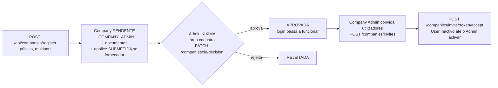
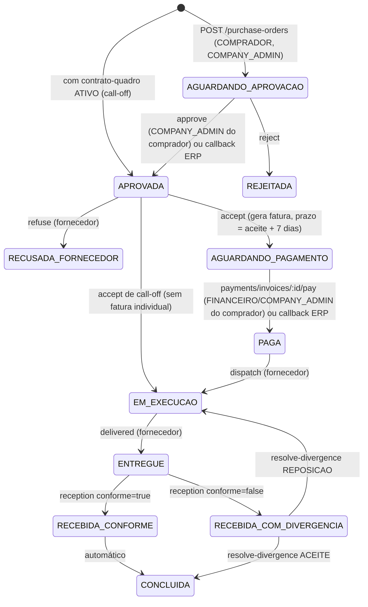
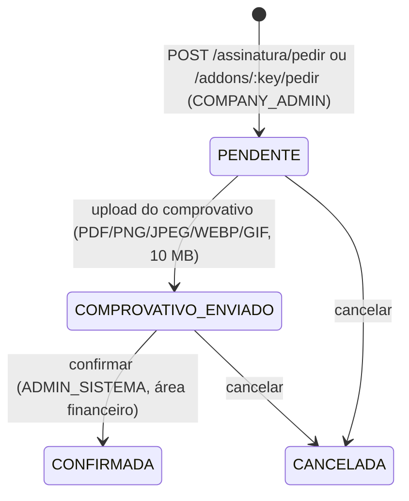

# 09 · Fluxos de negócio

> Descrição dos fluxos **como o código os implementa** (não como o produto os promete). Fontes: os `services/` indicados e as notas de cada grupo em [grupos/](grupos/). Para cada passo, o `openapi.yaml` tem a operação correspondente (campo `operationId`).

## 1. Ciclo de vida de uma empresa (onboarding)



- O primeiro utilizador (`COMPANY_ADMIN`) é criado já activo, mas **o login só funciona com a empresa `APROVADA`** (`services/authService.js:80`).
- Documentos obrigatórios: cliente = certidão comercial + alvará; fornecedor = alvará + licença ANPG + certidão + **apólice Fornecedor→KIXIMA** (`companyService.registerCompany`). Ficheiros PDF/imagem até 10 MB, com verificação dos primeiros bytes.
- Um fornecedor só é aprovado se tiver apólice não rejeitada. Apólices KIXIMA→Cliente são emitidas pelo Admin (área `apolices`); um job avisa 30 dias antes de expirarem.
- Convites: 7 dias, perfis convidáveis por tipo de empresa, limite de lugares do plano (BASE 2, CORE 5, PRO ilimitado).
- Alternativa sem convite: `POST /api/companies/users` — **contorna** limite de lugares e regras de perfis (achado SEG-17).
- Candidaturas **Supplier Development** (`/api/supplier-development/*`): pedido público com referência `SD-AAAA-NNNNNN`, taxa de acesso, gestão pelo Admin (área `suporte`); aprovar cria a empresa FORNECEDOR `PENDENTE` + apólice + convite de fundação (fora de transacção — [grupos/B](grupos/B-empresas.md), B-03).

## 2. Ordem de compra (PO) — o fluxo central «pagamento garantido»



Regras verificadas (`services/poService.js`, `paymentService.js`):

1. **Checkout:** o servidor recalcula tudo — preço vem do produto, IVA 14 % (`IVA_RATE`); o cliente só envia `productId` e `quantity`. O stock é decrementado atomicamente. Uma PO é sempre para **um** fornecedor e nunca para a própria empresa.
2. **Aceite do fornecedor:** numa só transacção, a PO passa a `AGUARDANDO_PAGAMENTO`, nasce a **fatura** (`FAT-AAAA-NNNNNN`), com série/número/hash fiscal se o fornecedor tiver `serieFiscal`, e a referência de pagamento `KXXXX-XXXX`. Só depois (fora da transacção, silencioso) a fatura é submetida à AGT.
3. **Pagamento:** o comprador paga com **comprovativo**; o montante **nunca** vem do cliente (é `Invoice.amount`). `Payment.invoiceId` único impede pagamento duplo. Gera-se a taxa da plataforma (`PlatformFee`, cobrada ao fornecedor) e o recibo `RC`.
4. **Entrega:** o fornecedor só pode despachar com a PO `PAGA`. O comprador confirma a recepção; divergência abre uma resolução (aceitar ou pedir reposição).
5. **Posse:** o papel só deixa passar no router; a verificação «esta PO é minha» (comprador ou fornecedor) é feita dentro do service.
6. Transições inválidas respondem `409 CONFLICT` (excepto *dispatch*: `400`). Não existe estado de cancelamento nem expiração.

### O prazo de 7 dias **não é aplicado**
`PAYMENT_SLA_DAYS` (omissão 7) só define `paymentDueAt`/`Invoice.dueAt`. Nenhum job, rota ou service marca `VENCIDA`, cancela ou avisa do vencimento; `VENCIDA`/`CANCELADA` e `PoStatus.ACEITE_FORNECEDOR` existem nos enums mas ninguém os escreve. O comprador pode pagar depois do prazo e a PO pode ficar `AGUARDANDO_PAGAMENTO` indefinidamente (achado A6 em [grupos/E](grupos/E-ordens-pagamento-fiscal.md)).

### Notas de crédito, conciliação e canais de pagamento

| Canal | Entrada | Efeito na fatura | Efeito na PO | Taxa | Recibo |
|---|---|---|---|---|---|
| `TRANSFERENCIA_MANUAL` | `POST /api/payments/invoices/{id}/pay` | `PAGA` | `PAGA` | sim | sim |
| `REFERENCIA_BANCARIA` | `POST /api/conciliacao/extrato` ou `/{id}/conciliar` | `PAGA` | **nenhum** | **não** | sim |
| `ERP` | callback HMAC do ERP | `PAGA` | `PAGA` | sim | sim |

A conciliação bancária deixa a PO em `AGUARDANDO_PAGAMENTO` (o fornecedor não pode despachar) e não cobra a taxa; além disso, está aberta ao papel `FINANCEIRO` de **qualquer** empresa (SEG-02). Uma fatura anulada por nota de crédito continua `PENDENTE` e pode ser paga pelo valor integral (A7).

## 3. Contratos-quadro e call-offs

- Um contrato `ATIVO` e válido entre comprador e fornecedor, cobrindo **todas** as categorias dos itens, faz a PO nascer como **call-off**: dispensa aprovação (`APROVADA`), o aceite leva-a directamente a `EM_EXECUCAO`, sem fatura individual nem SLA de 7 dias.
- `consolidate-billing` agrega call-offs numa fatura consolidada com `dueAt = hoje + contract.paymentTermDays`. Dois pedidos simultâneos podem emitir duas faturas para as mesmas call-offs (A8).
- **O tecto do contrato nunca é aplicado**: `usedValue` só é incrementado e nada compara com `totalValue` (A10 / F7).
- Nota/conciliação de faturas consolidadas (sem PO) ainda não está completa no Java ([10](10-frontend-java-e-integration-service.md), B4).

## 4. Facturação electrónica (AGT) e SAF-T

1. **Numeração interna** (opt-in por fornecedor via `Company.serieFiscal`): tabela `series_faturacao` por `(código, ano)`, `SELECT … FOR UPDATE`, hash SHA-256 encadeado. Sem `serieFiscal`, a fatura sai **sem série, número nem hash**.
2. **Numeração AGT** (`agtDocumentNo`): atribuída ao construir o payload e distinta da interna; submissão por `agtSandboxSubmissionService` (HML por omissão). Cada documento é enviado **duas vezes**, com dois formatos (ver [06](06-integracoes-externas.md), 1.4).
3. **SAF-T (AO):** `GET /api/faturacao/saft` gera XML à mão por empresa fornecedora e período. Estrutura mínima, sem XSD, sem produtos/impostos em `MasterFiles`, sem recibos, `InvoiceNo` diferente do número enviado à AGT. **Não está conforme** e o programa **não está certificado** (variáveis `AGT_SOFTWARE_VALIDATION_NUMBER`/`KIXIMA_CERTIFICADO_AGT` vazias por omissão). Não há no repositório evidência de que a AGT tenha aceite documentos.

## 5. Cotações (RFQ)

`ABERTA → RESPONDIDA → FECHADA`. O `COMPRADOR` pede cotação a **um** fornecedor (limite mensal por plano: BASE 3, CORE 20, PRO ilimitado); o fornecedor responde com preço total, prazo e nota (pode responder de novo, sobrescreve); o comprador encerra. As cotações são autónomas: **não geram PO** nem notificam ou auditam; `minQuantity`/`maxQuantity` nunca são aplicados ([grupos/D](grupos/D-catalogo-e-mercado.md)).

## 6. Catálogo, marketplace e API de catálogo

- Fornecedor: publica produtos (multipart, imagens/documentos limitados por plano), ajusta stock e movimentos, importa Excel (plano PRO, em *worker* isolado), gere chaves de API (plano PRO).
- **Integração por API** (`/api/v1/catalogo`): chave `kxm_…` (guardada com bcrypt), âmbito fixo na empresa da chave; ler, obter por SKU e actualizar preço/stock/disponibilidade.
- Comprador: marketplace com pesquisa sem acentos, facetas, comparação (até 5 fornecedores), pesquisas guardadas, favoritos.
- Atenção: a importação Excel sem coluna de preço publica o produto com um **preço calculado por categoria**, que depois é usado nas POs (achado #1 do grupo D).

## 7. Subscrições, add-ons e PO Robot



- Escada de planos **BASE < CORE < PRO** (`BASICO` = alias legado de CORE). Preço, período e meses ficam congelados no pedido; o plano só muda na **confirmação**, que é manual: a KIXIMA verifica a transferência (o sistema não valida valor nem titular).
- Só pode existir **uma** cobrança em aberto por empresa (índice único parcial na BD).
- O estado `ATIVA / A_EXPIRAR / GRACE / RESTRITA` não é persistido: calcula-se de `planoValidoAte` a cada leitura. Vencida há mais de `KIXIMA_GRACE_PERIOD_DAYS` (7), a subscrição fica `RESTRITA` e as funções premium bloqueiam (`PLANO_INSUFICIENTE`).
- Pagamento por gateway (`pagar-com`) só para BASE/CORE e os adaptadores estão «por ligar»; EMIS falha sempre (USD vs AOA).
- **PO Robot** (add-on, plano PRO): regras por produto/periodicidade; job diário às 06:00 cria POs em `AGUARDANDO_APROVACAO` em nome do Company Admin activo mais antigo. Nunca aprova nem paga. Regras inválidas só falham no cron e voltam a alertar todos os dias.

## 8. Integração ERP (plano PRO)

```
Admin KIXIMA (cadastro): PUT /api/companies/{id}/erp-config  ──►  cifra AES-256-GCM em BD ──► microserviço (credenciais)
PO criada/alterada ──► eventBus (RabbitMQ, opcional) ──► kixima-integration-service ──► ERP do cliente
ERP decide/paga ──► POST /api/integration/callback (HMAC-SHA256)
                      ├─ purchase_order.approval_decided ──► aplicarDecisaoErp  (PO erpManaged)
                      └─ payment.confirmed              ──► aplicarPagamentoErp (marca PAGA com o valor do ERP, sem o comparar com a fatura)
```

Sem `RABBITMQ_URL` o `eventBus` é *no-op*. A entrega é «no máximo uma vez» (sem confirmação do broker nem *retry*) e o callback não tem protecção contra repetição. As respostas nunca devolvem os segredos ERP (mascarados). Ver [06](06-integracoes-externas.md), secção 5, e [10](10-frontend-java-e-integration-service.md), secção A.

## 9. Suporte e Chat Comercial

- **Suporte:** ticket `ABERTO → EM_ANDAMENTO ⇄ AGUARDANDO_RESPOSTA → RESOLVIDO → FECHADO` (`SUP-AAAA-NNNNN`), com chat por ticket, fila e painel do assessor (área `suporte`). Algumas transições são automáticas ao enviar mensagens.
- **Chat Comercial:** conversa entre as duas empresas de uma PO/cotação/contrato/produto; qualquer utilizador da empresa vê todas as conversas dela; terceiros recebem 404. Cada mensagem é pontuada por 6 sinais (telefone, email, app externa, pagamento fora da plataforma, cancelar-para-continuar-fora, negócio à parte): `MEDIUM ≥ 4`, `HIGH ≥ 7`, `CRITICAL ≥ 11` criam um `RiskAlert` — **nunca bloqueiam** a mensagem. O assessor de Trust & Safety só vê conversas que tenham alerta, com auditoria do acesso.
- **Tempo real:** Socket.IO com salas `user:<id>`, `support:<ticketId>` e `conversation:<id>`; eventos `support:message`, `support:updated`, `conversation:message`, `conversation:risk-alert`, `notification:new`.

## 10. Jobs agendados que afectam estes fluxos

Expiração de apólices, expiração de subscrições (avisos D30/D7/D3/D1/D0/grace), PO Robot, lembrete de 2FA, retenção/limpeza de dados, cópia de segurança. **Não há** job de vencimento de pagamentos nem de reenvio de callbacks falhados ([05](05-base-de-dados-supabase.md), secção 8).
