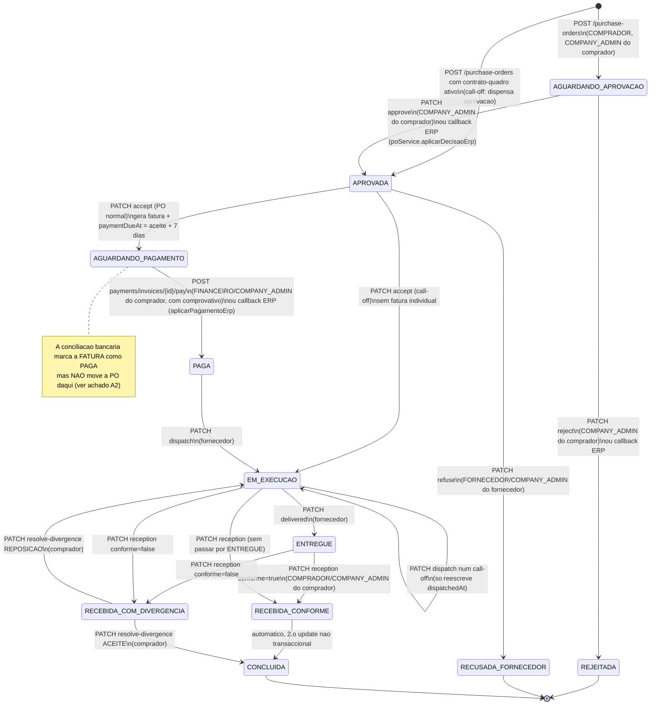

# Grupo E — Ordens de compra, pagamento e faturação fiscal

Âmbito: 36 endpoints (poRoutes 12, paymentRoutes 7, contractRoutes 4, faturacaoRoutes 8, conciliacaoRoutes 4, webhookPagamentoRoutes 1). Todos os do inventário `grupos/E_po_pagamento_fiscal.json` estão em `E_po_pagamento_fiscal.yaml` (verificado por script: 36 operações, `operationId` únicos, nenhum `$ref` por resolver, sem rotas a mais ou a menos). Todos os caminhos citados são relativos a `backend/src/`.

## (a) Resumo do grupo

### O que a API faz

É o fluxo central "pagamento garantido": o comprador emite uma PO a um fornecedor; o Company Admin do comprador aprova; o fornecedor aceita (o que gera a fatura fiscal e arranca o prazo de pagamento); o Financeiro do comprador paga com comprovativo; o fornecedor só despacha depois de a PO estar `PAGA`; o comprador confirma a recepção; a PO fecha. À volta disto há: notas de crédito/anulação, contratos-quadro com call-offs e faturação consolidada, conciliação do extracto bancário, SAF-T (AO), payloads e pedidos à AGT (e-Fatura) e um webhook de gateways de pagamento (este último serve só subscrições de plano).

A orquestração está em `services/poService.js` (cabeçalho com os 8 passos), `services/paymentService.js`, `services/faturacaoService.js`, `services/creditNoteService.js`, `services/conciliacaoService.js`, `services/contractService.js`, `services/saftService.js` e `services/agt*.js`. Os controllers `poController`/`paymentController`/`contractController` só delegam e gravam auditoria (`recordSafe`, não bloqueia). As rotas de faturação/conciliação têm handlers inline.

### Estados da PO e transições reais

`PoStatus` (prisma/schema.prisma:876) tem 12 valores; `ACEITE_FORNECEDOR` nunca é atribuído por nenhum código (o aceite vai directo para `AGUARDANDO_PAGAMENTO`). Todas as acções de fornecedor/comprador verificam também a posse por empresa no service (`companyId` do token = fornecedor ou comprador da PO); o papel só decide se o router deixa passar.

Tabela de transições (fonte: `services/poService.js`):

| De | Para | Endpoint / origem | Quem (router + posse no service) | Linha |
|---|---|---|---|---|
| (novo) | `AGUARDANDO_APROVACAO` | `POST /api/purchase-orders` | COMPRADOR, COMPANY_ADMIN; empresa = compradora | poService.js:146 |
| (novo) | `APROVADA` (call-off) | idem, com contrato-quadro `ATIVO` e válido que cubra todas as categorias | idem | poService.js:146 |
| `AGUARDANDO_APROVACAO` | `APROVADA` | `PATCH /{id}/approve`; ou callback ERP | COMPANY_ADMIN da empresa compradora (recusa call-off e `erpManaged`) | poService.js:274, :359 |
| `AGUARDANDO_APROVACAO` | `REJEITADA` | `PATCH /{id}/reject`; ou callback ERP | idem | poService.js:310 |
| `APROVADA` | `RECUSADA_FORNECEDOR` | `PATCH /{id}/refuse` | FORNECEDOR/COMPANY_ADMIN da empresa fornecedora | poService.js:608 |
| `APROVADA` | `AGUARDANDO_PAGAMENTO` | `PATCH /{id}/accept` (PO normal; cria fatura) | idem | poService.js:517 |
| `APROVADA` | `EM_EXECUCAO` | `PATCH /{id}/accept` (call-off) | idem | poService.js:528 |
| `AGUARDANDO_PAGAMENTO` | `PAGA` | `POST /api/payments/invoices/{id}/pay`; ou callback ERP | FINANCEIRO/COMPANY_ADMIN da empresa compradora | paymentService.js:114, poService.js:464 |
| `PAGA` (PO normal) ou `EM_EXECUCAO` (call-off) | `EM_EXECUCAO` | `PATCH /{id}/dispatch` | fornecedor | poService.js:633 |
| `EM_EXECUCAO` | `ENTREGUE` | `PATCH /{id}/delivered` | fornecedor | poService.js:651 |
| `ENTREGUE` ou `EM_EXECUCAO` | `RECEBIDA_CONFORME` -> `CONCLUIDA` | `PATCH /{id}/reception` (`conforme=true`) | COMPRADOR/COMPANY_ADMIN da empresa compradora | poService.js:670 |
| `ENTREGUE` ou `EM_EXECUCAO` | `RECEBIDA_COM_DIVERGENCIA` | `PATCH /{id}/reception` (`conforme=false`) | idem | poService.js:670 |
| `RECEBIDA_COM_DIVERGENCIA` | `CONCLUIDA` / `EM_EXECUCAO` | `PATCH /{id}/resolve-divergence` (`ACEITE` / `REPOSICAO`) | comprador | poService.js:720 |

Todas as outras combinações dão 409 `CONFLICT` (a dispatch fora de estado dá 400 `BUSINESS_RULE_VIOLATION`). Não existe estado de cancelamento nem transição por expiração.

### O SLA de 7 dias

- Valor: `config.business.paymentSlaDays` = variável `PAYMENT_SLA_DAYS`, por omissão 7 (config/env.js:282).
- Arranque: no `accept` de uma PO normal, `paymentDueAt = acceptedAt + 7 dias` (poService.js:538-539) e a mesma data vai para `Invoice.dueAt` (poService.js:578). É também o que a notificação `faturaGerada` mostra ao comprador.
- Call-offs: não têm prazo individual; na consolidação `dueAt = hoje + contract.paymentTermDays` e o mesmo prazo é copiado para `paymentDueAt` das POs (contractService.js:174-175, 217-220).
- **Aplicação: não encontrei nada que o faça cumprir.** Nenhum job (`jobs/` tem backup, mfa, poRobo, apólices, retenção, subscrições), nenhuma rota e nenhum service escreve `Invoice.status = VENCIDA` ou cancela a PO; `VENCIDA` e `CANCELADA` só são lidos (financeiroService.js:98, buyerService.js:87). O "vencido" é calculado ao vivo nos dashboards (`PENDENTE` com `dueAt < agora`). `processPayment` aceita pagar depois do prazo. Ver achado A6.

### Geração da fatura, série, numeração e hash

1. **Quando**: no `accept` (PO normal), dentro da mesma `$transaction` que passa a PO a `AGUARDANDO_PAGAMENTO` (poService.js:548-594); ou em `consolidate-billing` para call-offs (contractService.js:192-224).
2. **Referência interna** `FAT-AAAA-NNNNNN`: `nextReference` (`utils/reference.js`, contador atómico). É chamada com `prisma` e não com `tx`, portanto não reverte se a transacção falhar (buracos nesta referência, que não é o número fiscal).
3. **Valores**: `taxService.summarize` — IVA 14 % (`IVA_RATE`) por total líquido; retenção na fonte 6,5 % só em linhas de serviço (não soma ao total). `Invoice.amount` = total com IVA. As linhas (`InvoiceLine`) são cópia dos itens com `ivaTaxCode='NOR'`.
4. **Série fiscal interna** (`faturacaoService.atribuir`, faturacaoService.js:146): `codigo` = `Company.serieFiscal` do FORNECEDOR (fatura), `<serie>-NC` (nota de crédito), `<serie>-RC` (pagamento/recibo). Se o fornecedor não tem `serieFiscal` devolve `{}` e o documento sai SEM série, número nem hash (é opt-in por fornecedor).
5. **Numeração**: tabela `series_faturacao` com chave única `(codigo, ano)`; faz `INSERT ... ON CONFLICT DO NOTHING`, depois `SELECT ... FOR UPDATE` (serializa emissões simultâneas), `numero = ultimo_numero + 1`, e `UPDATE` com o novo hash. Tudo dentro da transacção do documento, por isso um rollback devolve o número (sem buracos). A numeração reinicia em 1 a cada ano. Série `ativa=false` => `Error` genérico (500). Data de emissão anterior a `Company.dataAdesaoFacturacaoElectronica` => `Error` genérico (500, espelha o erro E29 da AGT).
6. **Hash**: `SHA-256` em base64 do texto `AAAA-MM-DD;AAAA-MM-DDTHH:MM:SS;<serie>/<numero>;<total com 2 casas>;<hashAnterior>` (faturacaoService.js:105-114). Cada documento assina o hash do anterior na mesma série+ano; o primeiro do ano tem `hashAnterior = null`. NÃO é uma assinatura RSA; o código admite que a certificação AGT é um processo administrativo ainda por fazer.
7. **Referência de pagamento**: `KXXXX-XXXX` única por fatura (`conciliacaoService.atribuirReferencia`, dentro da transacção) — é o que o comprador escreve na transferência.
8. **Duas numerações distintas.** A numeração interna acima (`serie`/`numeroNaSerie`/hash) é independente do `documentNo` real enviado à AGT (`agtDocumentNo` = `<tipo> <seriesCode>/<n>`), atribuído só na primeira vez que se constrói o payload daquele documento, a partir de `agtseriesfe` (`agtSeriesService.atribuirDocumentNo`, agtSeriesService.js:203). O SAF-T usa a numeração interna; a AGT recebe a outra.
9. **Submissões à AGT** (todas após o commit, nunca desfazem o documento): FT no `accept` e na consolidação, NC na emissão, RC no pagamento — via `agtSandboxSubmissionService.submeter` (silencioso; sem configuração não faz nada; falhas vão para auditoria `AGT_SANDBOX_FALHOU`). Em `pay` há ainda um reenvio explícito e síncrono do FT (`agtPayloadService.submeterFatura`) cujo resultado é gravado em `Invoice.agt*` e devolvido na resposta.

### SAF-T (AO)

`GET /api/faturacao/saft` (`saftService.gerar`): XML feito à mão (sem biblioteca), `AuditFile` com `Header`, `MasterFiles/Customer`, `SourceDocuments/SalesInvoices`. É sempre de UMA empresa fornecedora (o emitente fiscal): o Fornecedor/Company Admin obtém o da sua empresa; o Admin do Sistema indica `supplierCompanyId`. Inclui faturas (`FT`) por `issuedAt` no período e notas de crédito (`NC`) por data de emissão da nota; uma fatura totalmente creditada sai como `InvoiceStatus=A`. Cabeçalhos de resposta `X-Kixima-Documentos` e `X-Kixima-Sem-Serie`. O próprio código declara-se não validado (comentários `NEEDS_AGT_CONFIRMATION`, `POR-CONFIGURAR`); as limitações verificáveis estão nos achados A12 e A13.

### Pagamento e conciliação

| Canal (`Payment.canal`) | Como entra | Efeito na fatura | Efeito na PO | Taxa da plataforma | Recibo (RC) |
|---|---|---|---|---|---|
| `TRANSFERENCIA_MANUAL` | `POST /api/payments/invoices/{id}/pay` com comprovativo | `PAGA` | `PAGA` + `paidAt` | sim (`PlatformFee`) | sim, série `-RC` |
| `REFERENCIA_BANCARIA` | `POST /api/conciliacao/extrato` ou `/{id}/conciliar` | `PAGA` | **nenhum** | **não** | sim, datado com `dataValor` do extracto |
| `ERP` | callback assinado do ERP (`integrationRoutes.js`, fora deste grupo) -> `poService.aplicarPagamentoErp` | `PAGA` | `PAGA` | sim | sim |
| `MULTICAIXA_EXPRESS` | existe no enum; nenhum código deste grupo o atribui | — | — | — | — |

O endpoint `/api/webhooks/pagamento/:canal` não confirma pagamentos de PO: só activa planos de subscrição (`PlanoCobranca`).

### Webhook de pagamento — segurança, idempotência

- Montagem: `app.js:200`, fora de `authenticate`, atrás só de `apiLimiter` (600/15 min).
- **Sem HMAC, sem segredo partilhado, sem lista de IPs.** O `rawBody` guardado em `app.js:99` não é usado por esta rota (o único HMAC do projecto visto é o do callback ERP em `integrationRoutes.js:35`, fora do âmbito).
- Defesa efectiva: o corpo só fornece `id`/`transactionId`; o adaptador consulta o gateway (`GET .../transactions/{id}` ou `/payments/{id}`, com credencial da plataforma) e só aceita o estado devolvido por ele. Um atacante sem controlo do gateway só consegue (i) disparar essa consulta, (ii) forçar a confirmação de uma transacção que o gateway já diz paga e que corresponda ao par `(canal, referenciaExterna)` de uma cobrança em aberto.
- Idempotência por estado (`confirmarViaGateway` devolve a cobrança se já `CONFIRMADA`); não é atómica (ver A5).
- Não compara montante/moeda devolvidos pelo gateway com a cobrança (A5).

### Concorrência e integridade, em resumo

Bem resolvido: numeração fiscal serializada por `FOR UPDATE` e revertida com a transacção; NC concorrentes sobre a mesma fatura (lock da linha da fatura + recálculo do saldo); duplo pagamento (`Payment.invoiceId` único => o segundo falha com 409, e o número RC reverte); duplo aceite (`Invoice.purchaseOrderId` único); stock decrementado atomicamente no checkout; callbacks ERP por `updateMany` condicionado ao estado. O montante pago nunca vem do cliente (é sempre `Invoice.amount`). Os problemas estão nas transições sem guarda atómica, na conciliação e na ausência de aplicação do SLA — ver abaixo.

## (b) Achados

Severidade: Crítica / Alta / Média / Baixa. "Confirmado?" = lido directamente no código; indico quando é inferência.

| # | Severidade | Tipo | Descrição | Evidência | Confirmado? |
|---|---|---|---|---|---|
| A1 | Alta | vulnerabilidade | A conciliação bancária é por papel e não por empresa. `FINANCEIRO` é um papel de empresa (o comprador paga com ele), e `requirePermission(FINANCEIRO)` só filtra `ADMIN_SISTEMA`; nem o router nem `conciliacaoService` verificam a empresa de quem chama. Qualquer utilizador FINANCEIRO de qualquer empresa pode: (a) submeter linhas de extracto inventadas com a `referenciaPagamento` e o valor de uma fatura e marcá-la `PAGA` sem dinheiro (a referência da sua própria fatura é conhecida do comprador); (b) escolher `dataValor` e assim a data/ano do recibo RC na série fiscal do fornecedor; (c) ler em `GET /por-resolver` linhas de extracto e faturas (referência, valor) de outras empresas; (d) reprocessar linhas alheias em `POST /{id}/conciliar`. Atacar faturas de terceiros exige conhecer a referência (espaço 32^8). | routes/conciliacaoRoutes.js:14,21,25,31; middleware/rbac.js (requirePermission); services/conciliacaoService.js:90-262 | Sim (leitura). Não confirmado se FINANCEIRO era pensado como papel interno da KIXIMA; `PersonaRole` e `paymentRoutes` dizem que é papel de empresa. |
| A2 | Alta | falha | Um pagamento conciliado por extracto deixa o fluxo preso: só põe `Invoice.status=PAGA` e cria o `Payment`. A PO continua `AGUARDANDO_PAGAMENTO` (sem `paidAt`), não se cria `PlatformFee`, não há notificação nem evento `payment.completed`. O fornecedor não pode despachar (`dispatch` exige PO `PAGA`) e o comprador já não consegue "pagar" (a fatura deixou de ser `PENDENTE`, 409). Não encontrei outro código que sincronize a PO. A taxa da plataforma deixa de ser cobrada nesse canal. | services/conciliacaoService.js:208-233 (sem tocar na PO nem em platformFee); services/poService.js:633-640; services/paymentService.js:60-62; grep `purchaseOrder.update` só em poService/paymentService/contractService | Sim |
| A3 | Alta | falha | A auditoria `PAGAMENTO_CONCILIADO` nunca é gravada: chama `auditService.record({...})` com um único argumento (a função espera `(client, entry)`), o destructuring do segundo parâmetro lança `TypeError` e o `.catch(() => {})` engole-o. Operação de dinheiro sem rasto, ao contrário de `pay`, que audita na transacção. | services/conciliacaoService.js:249-256; services/auditService.js:56 | Sim (leitura; não executado) |
| A4 | Alta | dívida (desenho) | O "pagamento garantido" assenta em prova autodeclarada: a PO passa a `PAGA` (e o fornecedor passa a poder despachar) assim que o FINANCEIRO do comprador carrega qualquer PDF/imagem válido. Ninguém verifica o dinheiro nesse ponto, e a confirmação de recepção pelo fornecedor (`confirm-received`) é só informativa — não é condição de nada. O montante registado é sempre o da fatura, sem comparação com o comprovativo. | services/paymentService.js:48-52,111-116; services/poService.js:633-640; services/paymentService.js:222-255 | Sim. A intenção de negócio (confiar no comprovativo) pode ser deliberada. |
| A5 | Média | vulnerabilidade | Webhook de pagamento público e sem verificação de assinatura/HMAC. A reconsulta ao gateway mitiga a falsificação, mas: (i) `verificado.montante` e `verificado.referencia` são ignorados (não se compara com `PlanoCobranca.valorUsd`); (ii) a idempotência é leitura-antes-de-escrita (dois callbacks simultâneos aplicam ambos `aplicarConfirmacao`: auditoria e notificação duplicadas); (iii) com o canal sem credenciais, `confirmarCallback` lança `Error` simples => 500 + Sentry, accionável por qualquer pessoa na internet (limitado só por `apiLimiter`); (iv) os adaptadores PayPay e bancos são declarados placeholders com campos "adivinhados". | routes/webhookPagamentoRoutes.js:15-38; services/multicaixaService.js:103-125; services/paypayService.js:84-105; services/bancoGatewayService.js:94-115; services/assinaturaService.js:441-445,602-625 | Sim |
| A6 | Alta | incompleto | O SLA de 7 dias não é aplicado: nenhum job nem rota marca `VENCIDA`, cancela a PO ou notifica o vencimento; `Invoice.status` `VENCIDA`/`CANCELADA` e `PoStatus.ACEITE_FORNECEDOR` existem no enum mas ninguém os escreve. O comprador pode pagar depois do prazo e o fornecedor fica com uma PO `AGUARDANDO_PAGAMENTO` indefinidamente. | services/poService.js:538-539; jobs/ (sem job de pagamento); grep `VENCIDA` só em leitura (financeiroService.js:98, buyerService.js:87) | Sim para o repositório. Pode existir processo externo ao repo (não confirmado). |
| A7 | Alta | falha | Uma fatura anulada/creditada continua `PENDENTE` e é paga pelo valor integral. `anular()` não altera `Invoice.status` (decisão documentada) e `processPayment` não consulta notas de crédito nem recalcula o valor: regista `Invoice.amount`. A PO também não é afectada. Idem na conciliação. | services/creditNoteService.js:197-199,206-213; services/paymentService.js:55-62,97-103; services/conciliacaoService.js:188-190 | Sim |
| A8 | Média | falha | `consolidate-billing` não é seguro contra pedidos simultâneos: lê as call-offs pendentes (`consolidatedInvoiceId=null`) fora da transacção e o `updateMany` de marcação só filtra por `id`; duas chamadas em paralelo emitem duas faturas (dois números fiscais) para as mesmas call-offs. Inclui também call-offs em `APROVADA` (ainda não aceites pelo fornecedor) e não aplica `billingPeriodicity` nem valida estado/validade do contrato. Selecção sujeita ao tecto silencioso de 1000 linhas (`config/database.js`). | services/contractService.js:152-224,156 | Sim (leitura; corrida não reproduzida) |
| A9 | Média | vulnerabilidade | O COMPRADOR pode forçar a emissão de faturas fiscais na série do FORNECEDOR: `consolidate-billing` aceita COMPANY_ADMIN/FINANCEIRO de qualquer das duas empresas do contrato. A fatura é emitida em nome do fornecedor (série, hash, SAF-T, AGT). | routes/contractRoutes.js:16; services/contractService.js:147-150,181-238 | Sim |
| A10 | Média | dívida | Call-offs: o tecto do contrato (`totalValue`) nunca é verificado (só se incrementa `usedValue`); o contrato é criado unilateralmente pela empresa cliente (o fornecedor não consente) e a PO resultante dispensa aprovação e pagamento antecipado (dispatch só exige `EM_EXECUCAO`). `approvalCap` do utilizador e `BudgetLimit` também não são consultados ao aprovar. O comentário de `createPurchaseOrder` fala em "limite de orçamento", que não existe no código deste fluxo. | services/poService.js:161-168,282-293,633-640; services/contractService.js:46-71; grep `usedValue`/`totalValue`/`approvalCap` | Sim |
| A11 | Média | falha | `reject` (comprador) e `refuse` (fornecedor) não repõem o stock decrementado no checkout nem `Contract.usedValue` do call-off. Um fornecedor com `stockQuantity` definido perde stock por POs que não se concretizam. | services/poService.js:113-131,310-340,608-623 (nenhum `increment` de stock ou decremento de `usedValue`) | Sim (ausência por leitura de poService; não vi outro ponto que o faça) |
| A12 | Média | falha | Transições da PO sem guarda atómica (`update` por `id`, sem `status` no `where`): `approve`/`reject` simultâneos, ou `accept`/`refuse` simultâneos, passam todos a verificação inicial e a última escrita ganha. Caso grave: `refuse` a seguir a `accept` deixa a PO `RECUSADA_FORNECEDOR` com uma fatura `PENDENTE` já emitida (e submetida à AGT) e ainda paga­vel. `dispatch`/`delivered`/`reception`/`resolve-divergence` têm o mesmo padrão. | services/poService.js:294,328,616,642,659,680,733 | Sim (leitura; corrida não reproduzida) |
| A13 | Média | falha | Receção conforme faz dois `update` sequenciais fora de transacção (`RECEBIDA_CONFORME` e depois `CONCLUIDA`); se o segundo falhar a PO fica em `RECEBIDA_CONFORME` sem endpoint para a fechar. | services/poService.js:680-706 | Sim |
| A14 | Média | falha | `GET /integridade` produz resultados errados: a consulta não filtra por `ano` mas a numeração reinicia por (série, ano) e o primeiro hash de cada ano tem `hashAnterior=null`, logo com mais de um ano acusa `BURACO_NA_NUMERACAO`/`ELO_PARTIDO` falsos; só verifica `Invoice`, por isso uma série `-NC`/`-RC` devolve `integra:true` com 0 documentos (falsa segurança); o hash é recalculado com `issuedAt` e foi calculado na emissão com `new Date()` do código (carimbo ao segundo), pelo que pode dar falso `DOCUMENTO_ALTERADO`. Resposta com chaves diferentes (`verificada`/`integra`) consoante haja ou não `serie`. | services/faturacaoService.js:206-266; poService.js:563-567 e :569-585 (`emitidaEm` vs `issuedAt` por omissão) | Os dois primeiros: sim. O terceiro: não confirmado em execução. |
| A15 | Média | falha | No canal de referência bancária, o recibo RC é emitido com `emitidaEm = dataValor` da linha do extracto (data do banco, controlada por quem importa — ver A1). Pode cair num ano anterior (cria/usa a série desse ano), ficar fora de ordem cronológica na cadeia e rebenta se a série estiver fechada ou a data for anterior à adesão (`Error` genérico => 500 a meio do lote). | services/conciliacaoService.js:209-214,228-229; services/faturacaoService.js:150-158,175-177 | Sim |
| A16 | Média | incompleto | Numeração fiscal opt-in: sem `Company.serieFiscal` a fatura/NC/RC são emitidas sem série, número nem hash (`atribuir` devolve `{}`); no SAF-T saem com a referência interna `FAT-...` e `X-Kixima-Sem-Serie` > 0. A integridade fiscal só vale para os fornecedores que a activaram. | services/faturacaoService.js:146-148; services/saftService.js:231-237,348 | Sim |
| A17 | Média | incompleto | SAF-T: (i) `InvoiceNo` usa a série interna, não o `agtDocumentNo` enviado à AGT; (ii) não inclui recibos/pagamentos (RC) nem produtos/impostos em `MasterFiles`; (iii) `TotalCredit` só soma faturas e `TotalDebit` é 0; (iv) `CurrencyCode` fixo `AOA` mas faturas de contrato podem ter outra moeda; (v) `SoftwareCertificateNumber` cai em `'0'` (o comentário diz "vazio"); (vi) o `Hash` é SHA-256 interno, não assinatura RSA; (vii) limite silencioso de 100000 documentos; (viii) não validado contra o XSD. O próprio ficheiro reconhece vários destes pontos. | services/saftService.js:166-196,221-227,235-237,336-356; services/agtPayloadService.js:79-82 | Sim (leitura). Conformidade com a AGT: não confirmado. |
| A18 | Média | dívida | Dois GET com efeitos: `GET /agt-payload/:tipo/:id` reserva e grava o `agtDocumentNo` (consome um número da série AGT numa simples pré-visualização, gerando lacunas); `GET /agt-serie-payload` submete mesmo um pedido de série à AGT e grava `AgtSeriesFe` (não idempotente); `GET /agt-estado/:id` faz uma chamada POST à AGT. O contador `ultimoNumero` não é limitado por `authorizedQuantity`/`lastDocumentNo`. | routes/faturacaoRoutes.js:118-144,161-190; services/agtSeriesService.js:203-236 | Sim |
| A19 | Baixa | dívida | Pedidos à AGT feitos dentro do pedido HTTP do utilizador: `accept`, `pay` (reenvio do FT + `obterEstado` + RC), `anular`, `consolidate`. Aumenta a latência e acopla a UX à disponibilidade da AGT; `pay` reenvia o FT em cada pagamento (o código admite que a AGT pode recusar por `documentNo` repetido). A resposta de `pay`/`anular` devolve `payload`, `resposta` e `erro.details.respostaBruta` da AGT ao cliente. | services/paymentService.js:149-217; services/creditNoteService.js:202-259; services/poService.js:604 | Sim |
| A20 | Baixa | dívida | Validação em falta: notas de crédito, anulação e conciliação não têm schema Zod (validação manual; `motivo` e `amount` sem limites; linhas do extracto sem limite de número); `GET /purchase-orders?status=` aceita qualquer texto (valor fora do enum => 500); `createContract` não valida existência do fornecedor (FK => 500), nem `validUntil > validFrom`, nem fornecedor ≠ cliente; `createPurchaseOrder` devolve "Um ou mais produtos não encontrado." quando o mesmo `productId` vem repetido; `quantity` sem máximo. | services/creditNoteService.js:70-77; routes/conciliacaoRoutes.js:14-27; services/poService.js:48-51,245-247; services/contractService.js:35-72; utils/schemas.js:349-358,406-416 | Sim |
| A21 | Baixa | dívida | O comprovativo de pagamento é gravado antes da transacção e fica órfão se esta falhar ou se o pagamento for duplicado (409). `nextReference('FAT')` também é chamado fora da transacção (buracos na referência interna, não no número fiscal). | services/paymentService.js:69-76; services/poService.js:557 | Sim |
| A22 | Baixa | dívida | Multicaixa Express não consegue iniciar subscrições: `assinaturaService` pede sempre em `USD` e `multicaixaService.pedirPagamento` recusa moeda ≠ AOA. | services/assinaturaService.js:568-573; services/multicaixaService.js:66-71 | Sim (leitura; não executado) |
| A23 | Baixa | dívida | `ADMIN_SISTEMA` lê todas as POs e contratos sem `requirePermission` de área; e `GET /purchase-orders` devolve a lista completa (sem `page`) com `payment.proofUrl` incluído; `GET /{id}` expõe `iban`/`swift`/contactos de ambas as empresas às duas partes (por desenho). | services/poService.js:245-270,197; services/contractService.js:87-95 | Sim; o último ponto é provavelmente intencional. |

### Idempotência e integridade — verificado

| Pergunta | Resposta | Evidência |
|---|---|---|
| Pagamento duplicado da mesma fatura? | Não: `Payment.invoiceId` único; o segundo recebe 409 `UNIQUE_CONSTRAINT` e o RC reverte. Mas a mensagem é genérica e o comprovativo fica órfão. | prisma/schema.prisma:1405; paymentService.js:55-62,97 |
| Montante manipulável pelo cliente? | Não: o montante é `Invoice.amount`. Sem comparação com comprovativo/extracto (excepto na conciliação, que exige igualdade ao cêntimo e mesma moeda). | paymentService.js:99-101; conciliacaoService.js:180-193 |
| Numeração fiscal com buracos/duplicados? | Serializada por `FOR UPDATE`, revertida com a transacção, única por `(codigo, ano)`. Risco real só nas condições de A14–A16. | faturacaoService.js:162-187 |
| NC acima do saldo? | Não: lock da fatura + saldo recalculado dentro da transacção. | creditNoteService.js:110-119 |
| Callbacks de ERP idempotentes? | Sim, por estado + `updateMany` condicionado / `P2002` tratado (fora deste grupo de rotas, mas no service do grupo). | poService.js:359-414,420-513 |
| Webhook de gateway idempotente? | Por estado, não atómico (A5). | assinaturaService.js:602-625 |

## (c) Dúvidas por resolver

1. `FINANCEIRO` na conciliação (A1): é intencional que qualquer Financeiro de empresa aceda ao extracto da plataforma? Se o extracto é interno da KIXIMA, a rota devia exigir `ADMIN_SISTEMA`. Não encontrei documentação que o decida.
2. Aplicação do SLA de 7 dias (A6): pode haver um cron/serviço externo (ex.: em `kixima-integration-service/` ou na infra) que o faça; pesquisei só `backend/src`.
3. `issuedAt` vs `emitidaEm` (A14): não confirmei em execução se os dois carimbos diferem (a diferença pode ser < 1 s e o texto assinado usa precisão de segundos).
4. Limite de tamanho do corpo em `/api/conciliacao/extrato`: `app.js:99` usa `express.json` sem `limit` (portanto o padrão de 100 kB do Express); não confirmei nenhuma configuração externa.
5. Conformidade AGT: se a numeração interna (`serie.ano/N` + hash SHA-256) é a que a AGT espera no SAF-T ou se devia coincidir com o `documentNo` AGT; os próprios comentários do código dizem que depende de decisão do contabilista/certificação.
6. `config/agt.js`/`agtSandboxClient.js` não foram lidos por inteiro (só o que as rotas expõem); o comportamento exacto das chamadas de rede à AGT (timeouts, retentativas) não está documentado aqui.
7. Paridade com `backend-java/`: não verifiquei se o espelho Java replica estas regras e falhas.
8. `callbacks` do ERP (`routes/integrationRoutes.js`, HMAC próprio) não pertencem a este grupo; só li o necessário para confirmar que existem e que chamam `aplicarDecisaoErp`/`aplicarPagamentoErp`.
